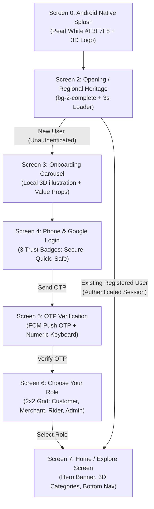

# Abashyaka Mobile Agent Guide — Premium UI/UX Implementation Standards

> **Authoritative Specification & Operational Handbook for Coding Agents**  
> **Platform Brand:** Abashyaka (under Grepmind) — *Everything nearby. One tap away.*  
> **Target Framework:** Flutter 3.47.x / Dart 3.13.x (Riverpod State, Dio Networking, GoRouter)

---

## 1. Executive Summary & Design System Identity

This document defines the authoritative, mandatory UI/UX standards, screen architecture, design tokens, reusable components, and build rules for the Abashyaka mobile application. Any agent modifying or extending the mobile interface must strictly follow this guide.

### Approved Design Language:
**Metallic Teal Abstract Fluid Wave + Pearl White Glossy UI**

- **Light-First Aesthetics:** Pure Pearl White (`#F3F7F8` / `#FFFFFF`) glossy canvas.
- **Brand Colors:** Deep Metallic Teal (`#00545B`), Vibrant Teal/Aqua (`#008C95` / `#0F766E`), and Mint Wave gradients.
- **Card Styling:** Ultra-clean pearl white glossy cards (`borderRadius: 20`–`24`), thin subtle borders (`#E2E8F0` / `#F1F5F9`), and multi-layer soft ambient shadows.
- **Typography:** Inter typography hierarchy (`AbashyakaTypography`), legible scaling, and accessible contrast.
- **Motion & Feedback:** Fluid transitions, non-blocking 3-second animated dots loader, tactile pill buttons, and native virtual IME keyboard integration.

---

## 2. Mandatory Build Command

All debug and QA validation APKs must be built using this exact command with all required flavor and `--dart-define` parameters. Missing any of these parameters will break backend API connectivity and FCM push OTP delivery:

```bash
cd /mnt/d/grepmind-near/apps/mobile && /home/grepmind/projects/flutter-setup/develop/flutter/bin/flutter build apk --debug --no-pub --flavor development --dart-define=API_BASE_URL=https://api.abashyaka.com --dart-define=FCM_TEST_OTP_ENABLED=true --dart-define=GOOGLE_SERVER_CLIENT_ID=666331814501-v2vtkg0t27b5ld6edavtqkm8dlkr94l3.apps.googleusercontent.com
```

### Parameter Explanations:
1. `--flavor development`: Targets package `com.abashyaka.app.dev` and processes `apps/mobile/android/app/src/development/google-services.json`.
2. `--dart-define=API_BASE_URL=https://api.abashyaka.com`: Points API client (`apiClient`) to the active Abashyaka production/staging backend.
3. `--dart-define=FCM_TEST_OTP_ENABLED=true`: Activates pre-login FCM token device registration (`/devices/register-prelogin`) so backend sends OTP codes via push notifications.
4. `--dart-define=GOOGLE_SERVER_CLIENT_ID=...`: Supplies the authorized Google OAuth web server client ID.

### Installation & Launching on Emulator:
```powershell
# 1. Compute & verify SHA-256
Get-FileHash D:\grepmind-near\apps\mobile\build\app\outputs\flutter-apk\app-development-debug.apk -Algorithm SHA256

# 2. Install on assigned emulator (Customer: emulator-5554 / Pixel_8)
adb -s emulator-5554 install -r D:\grepmind-near\apps\mobile\build\app\outputs\flutter-apk\app-development-debug.apk

# 3. Launch app
adb -s emulator-5554 shell monkey -p com.abashyaka.app.dev -c android.intent.category.LAUNCHER 1
```

---

## 2.1. Category Taxonomy & Location Serviceability Rules (Mandatory)

All coding agents implementing or modifying category grids, directories, and discovery search must adhere to `docs/design/ABASHYAKA_CATEGORY_TAXONOMY_V2.0.md`:

1. **The 18 Top-Level Categories Only**:
   * `food`, `grocery`, `medicines`, `doctors`, `cab_auto`, `services`, `electronics`, `shops`, `fashion`, `hotels_stays`, `fitness_wellness`, `beauty_salon`, `automobile`, `education`, `home_furniture`, `events_catering`, `agriculture`, `construction`.
2. **Consolidation of Trades & Sub-Shops**:
   * **Never create separate top-level categories** for Plumber, Electrician, Carpenter, AC Mechanic, Home Painting & Decor, or Cleaning. They must reside under **Services** (`services`).
   * **Never create separate top-level categories** for Tailor/Tailoring. Tailor must reside under **Shops** (`shops`) or Fashion.
3. **Location Serviceability Standard**:
   * Only show **Admin-Approved Service Places** (Chhatia, Kuanpal, Jagatpur, Tangi, Chandikhol).
   * **Never display raw 6-digit pincode tags** (e.g. `751007`) in UI badges or filters.
   * Only show clean place names with distance in km (e.g. `Chhatia • 1.2 km`, `Kuanpal • 0.8 km`), synchronized with the Home tab.

---

## 3. Screen Order & Architecture (Screens 0 to 7)



### Screen 0: Android Native Splash
- **Path / Resource:** `apps/mobile/android/app/src/main/res/values/abashyaka_colors.xml`, `launch_background.xml`
- **Background:** Solid Pearl White (`#F3F7F8`).
- **Logo:** Centered 3D brand logo emblem (`@drawable/abashyaka_splash_emblem` matching `Final-Logo.png`).
- **Standard:** Immediate native OS cold-boot presentation with zero letterboxing or dark flickering.

### Screen 1: Flutter Dark Splash (Fallback / Loading)
- **Path / Widget:** `apps/mobile/lib/core/screens/splash_screen.dart` (`SplashScreen.dark()`)
- **Use Case:** Historical dark fallback. Active app flow defaults to `SplashScreen()` (Screen 2).

### Screen 2: Opening / Regional Heritage
- **Path / Widget:** `apps/mobile/lib/core/screens/splash_screen.dart`
- **Background:** Full approved single graphic `assets/backgrounds/premium/opening_complete.png` (`bg-2-complete.png`) fitted as a `BoxDecoration`.
- **Artwork Cleanliness:** Zero duplicate overlaid Flutter widgets (separate text, logos, or temple cutouts must NOT be rendered on top of `opening_complete.png`).
- **Interactive Element:** Non-blocking 3-second animated dots loader (`_SplashLoadingDots`) rendered in the open sky area above the temple artwork.
- **Auto-Transition:** Automatically transitions after 3 seconds:
  - If **unauthenticated**: transitions to `IntroductionScreen` (Screen 3).
  - If **authenticated**: transitions directly to `MainNavigator` (Screen 7), cleanly bypassing Onboarding & Login.

### Screen 3: Get Started / Onboarding
- **Path / Widget:** `apps/mobile/lib/features/onboarding/introduction_screen.dart`
- **Background:** `assets/backgrounds/premium/onboarding_background.webp`.
- **Illustration:** `assets/illustrations/onboarding_local_3d.webp` (centered above fluid waves).
- **Actions:** Skip (top-right), page indicator dots, and glossy metallic `Get Started →` button.

### Screen 4: Login (Phone & Google)
- **Path / Widget:** `apps/mobile/lib/core/screens/onboarding_screen.dart`
- **Background:** `assets/backgrounds/premium/login_background.webp`.
- **Header:** Centered 3D lock emblem (`abashyaka_logo.png`), brand title `Abashyaka` in metallic teal, and `Login to Continue`.
- **Form:** Floating mobile number input with Indian flag `🇮🇳` prefix (`+91`), followed by metallic gradient button `Send OTP →`.
- **Trust Badges:** Bottom row of 3 cropped icons (`apps/mobile/assets/icons/authentication/`):
  1. `secure_login.png`: "Secure Login"
  2. `quick_easy.png`: "Quick & Easy"
  3. `data_safe.png`: "Your Data Safe"

### Screen 5: OTP Verification
- **Path / Widget:** `apps/mobile/lib/core/screens/onboarding_screen.dart` (`_otpStep()`)
- **Background:** `assets/backgrounds/premium/otp_background.webp`.
- **Illustration:** `assets/illustrations/otp_verification.webp` (above the bottom wave).
- **Input:** 6 individual PIN cells backed by numeric virtual IME (`keyboardType: TextInputType.numberWithOptions(signed: false, decimal: false)`).
- **Keyboard Behavior:** `TextInput.show` is explicitly called on mount so the on-screen soft keyboard pops up automatically.
- **FCM Delivery:** Pre-login FCM device registration allows immediate push notification delivery of the OTP code.
- **Actions:** `Verify & Continue` button, 60-second resend countdown timer, and `Change mobile number` link.

### Screen 6: Role Selection / Choose Your Role
- **Path / Widget:** `apps/mobile/lib/core/screens/role_selection_screen.dart`
- **Background:** `assets/backgrounds/premium/role_selection_background.webp` (fluid wave header & footer).
- **Top Header:** Centered 3D lock logo, bold `Abashyaka` text, `Choose Your Role`, and subtitle `Select how you want to use Abashyaka`.
- **2x2 Grid Layout:** 4 white glossy cards (`borderRadius: 24`, shadow blur: 16):
  1. **Customer** (Top-Left): 3D customer holding phone & bag (`assets/icons/roles/customer.png`), title `Customer`, description `Discover shops, order food & grocery, and book services.`, and mint green pill `Continue as Customer →` (`#E8F7EE` / `#15803D`).
  2. **Merchant** (Top-Right): 3D storefront (`assets/icons/roles/merchant.png`), title `Merchant`, description `List your business, manage orders, services and customers.`, and warm amber pill `Continue as Merchant →` (`#FEF3C7` / `#B45309`).
  3. **Rider** (Bottom-Left): 3D delivery scooter rider (`assets/icons/roles/rider.png`), title `Rider`, description `Pick orders, deliver to customers and earn with Abashyaka.`, and sky blue pill `Continue as Rider →` (`#E0F2FE` / `#0284C7`).
  4. **Admin** (Bottom-Right): 3D laptop with analytics & purple shield (`assets/icons/roles/admin.png`), title `Admin`, description `Manage the platform, users, listings and operations.`, and lavender pill `Continue as Admin →` (`#F3E8FF` / `#7E22CE`).
- **Interaction:** Tapping any enabled card or its pill button immediately activates that workspace role and navigates to it.
- **RBAC Security:** Locked roles (e.g. unapproved riders) safely prevent unauthorized role switching and display status badges or entry to `RiderApplicationScreen`.

### Screen 7: Home / Explore Screen
- **Path / Widget:** `apps/mobile/lib/core/screens/home_screen.dart` & `explore_screen.dart`
- **Header:** Sticky branded header with 3D logo, `Abashyaka`, subtitle `Everything nearby, one tap away`, and Odia script `ଆବଶ୍ୟକ`.
- **Search Bar:** Glossy search pill with voice search icon and filter options.
- **Location Selector:** Interactive locality chip (e.g., `Bhubaneswar, Odisha`).
- **Hero Promotional Banner:** Metallic teal gradient banner with 3D shopping bag graphic.
- **3D Category Grid:** 12 categories rendered with rich 3D icons (`apps/mobile/assets/categories/`): Food, Grocery, Cab & Auto, Medicines, Services, Electronics, Doctors, Shops, Fashion, Hotels, Wellness, and More.
- **Bottom Navigation Bar:** Floating 5-tab bar with pill indicator (`Home`, `Explore`, `Nearby`, `Orders`, `Profile`).

---

## 4. Centralized Theme & Design Tokens

All widgets and screens must reference tokens from `lib/core/theme/`:

### Colors (`AbashyakaColors`)
| Token Name | Hex Code | Purpose |
|---|---|---|
| `signatureTeal` | `#00545B` | Primary brand base, dark buttons, active text, hero anchors |
| `metallicTeal` | `#007D80` | Primary brand accent, interactive buttons, active icons |
| `luminousAqua` | `#00B3AE` | Secondary gradient accent, glowing wave highlights, active rings |
| `metallicGold` | `#F4B942` | Warm ratings star, verified badge, promotional accents |
| `pearlWhite` | `#F5FAFA` | Primary light canvas background (prevents glare) |
| `pureWhite` | `#FFFFFF` | Card surface, modal sheets, glossy containers |
| `premiumObsidian` / `inkBlack` | `#101820` | Primary typography, page titles, card headings |
| `graphiteCharcoal` / `secondaryText` | `#374151` | Subtitles, supporting copy, addresses, metadata |
| `aquaSilverBorder` | `#DCEBED` | Subtle, refined card outlines with gentle aqua tone |
| `pillGreen` | `#15803D` / `#E8F7EE` | Customer role accents & pill |
| `pillAmber` | `#B45309` / `#FEF3C7` | Merchant role accents & pill |
| `pillBlue` | `#0284C7` / `#E0F2FE` | Rider role accents & pill |
| `pillPurple` | `#7E22CE` / `#F3E8FF` | Admin role accents & pill |

### Gradients (`AbashyakaGradients`)
- `primaryWave`: `LinearGradient([#00545B, #008C95, #28B7A4])`
- `metallicButton`: `LinearGradient([#00545B, #008C95])`
- `pearlGloss`: `LinearGradient([#FFFFFF, #F8FAFC])`

### Component Radii (`AbashyakaRadius`)
- `card`: `20.0` to `24.0` dp
- `button`: `20.0` to `26.0` dp (stadium/pill shape)
- `input`: `16.0` dp
- `badge`: `16.0` to `20.0` dp

---

## 5. Reusable Components Reference

Agents must reuse existing building blocks rather than inventing one-off widgets:

1. **`AbashyakaPremiumHeader`** (`lib/core/widgets/abashyaka_premium_header.dart`): Centered or left-aligned fluid wave header with logo and subtitles.
2. **`Category3DIcon`** (`lib/core/widgets/category_3d_icon.dart`): Square card with rounded corners, 3D icon asset, and typography label.
3. **`MetallicButton`** (`lib/core/widgets/metallic_button.dart`): Glossy button with tactile ink splash and drop shadow.
4. **`PremiumCard`** (`lib/core/widgets/premium_card.dart`): White glossy container with standardized radius, border, and shadows.
5. **`FloatingBottomNavigation`** (`lib/core/widgets/floating_bottom_navigation.dart`): Centered floating nav dock with active pill highlight.
6. **`PremiumSearchBar`** (`lib/core/widgets/premium_search_bar.dart`): Input container with trailing voice and filter icons.

---

## 6. Testing & Quality Gates

Every code change touching UI, navigation, or auth must pass:

1. **Static Analysis & Formatting:**
   ```bash
   cd /mnt/d/grepmind-near/apps/mobile && /home/grepmind/projects/flutter-setup/develop/flutter/bin/dart format lib/ test/
   ```

2. **Automated Test Suite (16 Core Auth & Role Tests):**
   ```bash
   cd /mnt/d/grepmind-near/apps/mobile && /home/grepmind/projects/flutter-setup/develop/flutter/bin/flutter test test/abashyaka_entry_test.dart test/auth_onboarding_test.dart test/role_selection_test.dart
   ```
   *Expectation: 100% passing tests with zero regressions.*

3. **Multi-Role Emulator Validation:**
   - **Customer:** `emulator-5554` (`Pixel_8`)
   - **Merchant:** `emulator-5556` (`Pixel_8_Merchant_QA`)
   - **Rider:** `emulator-5558` (`Pixel_8_Rider_QA`)
   - Always verify SHA-256 before installation and capture screenshots of actual device state.
