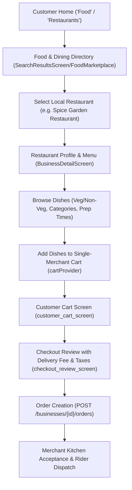
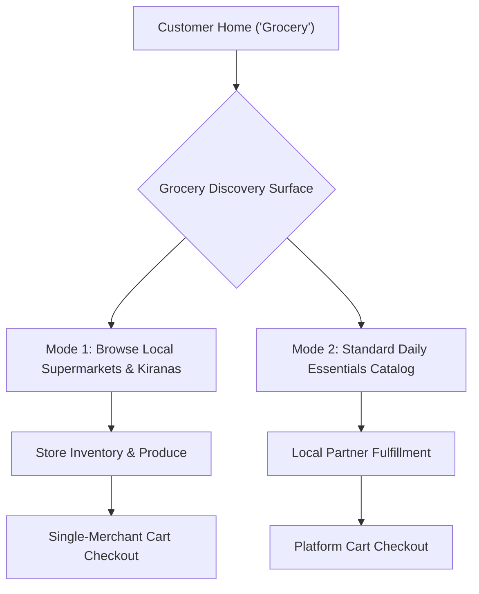

# ABASHYAKA — FOOD & GROCERY CATALOG ARCHITECTURE (GATE 3)
## Merchant-Owned Restaurant Menus, Single-Merchant Carts & Marketplace Separation

**Date:** 19 November 2026  
**Status:** **GATE 3 — COMPLETED & ACCEPTED (PASS)**  
**Branch:** `abashyaka-dev-01`  
**Target Surfaces:** Customer Mobile Application (`apps/mobile`), Go Backend REST API (`backend`), PostgreSQL PostGIS  

---

## 1. Executive Summary & Problem Analysis

In standard local e-commerce platforms, forcing **Food Delivery** and **Grocery** into a single, unified "Platform Catalog" creates fundamental user-experience breakdowns:
1. **Obscured Merchant Identity:** Customers do not order "Generic Biryani" from an anonymous platform warehouse. In local commerce, customers choose **specific restaurants** (e.g. *Spice Garden Restaurant*, *Biryani Hub*, *Maa Tarini Dhaba*) based on reputation, taste, hygiene, and distance.
2. **Menu Diversity & Preparation:** Restaurant menus are dynamic, chef-driven, and merchant-specific with culinary categories (Starters, Main Course, Tandoor, Desserts), preparation times, and dietary markers (Pure Veg, Non-Veg, Halal). A flat SKU-based platform catalog cannot capture local restaurant cooking.
3. **Delivery Serviceability Boundaries:** A customer in Kuanpal cannot order hot food from a restaurant in Badambadi (25 km away), whereas packaged long-shelf goods may have wider delivery boundaries.
4. **Single-Merchant Cart Invariant:** Food ordering must enforce **strict single-merchant isolation**. A customer cannot combine items from two different restaurants into one cooking and dispatch ticket without multi-stop rider routing and split payments.

**The Solution:**
Separating Food Delivery into an explicit **Merchant-First Restaurant Marketplace** while preserving the standardized FMCG Grocery Catalog and Local Supermarket storefronts.

---

## 2. Architectural Comparison: Merchant-Owned vs. Platform Catalog

The Grepmind Near backend already possesses two mature catalog pipelines:

| Architectural Dimension | Model A: Merchant-Owned Catalog (Food / Local Retail) | Model B: Platform Catalog (FMCG Grocery) |
|---|---|---|
| **Database Tables** | `businesses`, `products`, `business_categories` | `platform_catalog_products`, `platform_catalog_variants`, `platform_partner_fulfillment` |
| **Catalog Ownership** | Individual local restaurant or merchant | Platform-curated standard barcode/SKU catalog |
| **Merchant Identity** | **Primary.** Merchant name, photo, location, rating are front-and-center. | Secondary. Fulfilled by an assigned partner. |
| **Cart Model** | `cartProvider` (`CartState.businessId` - single merchant) | `platformCartProvider` (`vertical`, `localityId`) |
| **Order Creation** | `POST /api/v1/businesses/{id}/orders` | `POST /api/v1/platform-orders` |
| **Inventory Control** | Real-time `available_quantity` & `stock_status` per business | Partner fulfillment stock thresholds |
| **Applicable Verticals** | **Food Delivery, Bakeries, Cloud Kitchens, Local Specialty Shops** | **Daily Packaged Groceries, FMCG, Staples** |

---

## 3. Dedicated Vertical Architecture

### A. Food Delivery Vertical (100% Merchant-First)

1. **Discovery:**
   - Tapping **Food** on Customer Home or **Restaurants** under *Popular near you* opens the **Food & Dining Directory** showing approved nearby restaurants.
   - Shows: Restaurant Name, Cuisines, Distance, Locality, Delivery Time (`delivery_time_mins` e.g. 30–35 min), Delivery Fee (`delivery_fee`), Minimum Order, and Pure Veg / FSSAI tags.
2. **Menu Inspection:**
   - Tapping a restaurant opens `BusinessDetailScreen` with dedicated Food Menu tabs.
   - Dishes are organized by category (*Starters*, *Main Course*, *Biryani*, *Breads*), with Veg green dot / Non-veg brown triangle badges, pricing, and ingredients.
3. **Single-Merchant Cart Isolation:**
   - Managed via `cartProvider`.
   - If the customer attempts to add an item from a second restaurant, the UI prompts: *"Replace cart items? Your cart contains items from [Existing Restaurant]. Clear cart to add from [New Restaurant]?"*
4. **Checkout & Fee Transparency:**
   - Navigates to `CheckoutReviewScreen`.
   - Explicitly displays:
     - Item Subtotal (Server-verified)
     - Delivery Fee (Merchant-specific or distance-tiered)
     - GST / Packaging charges
     - Estimated Delivery Time
     - Delivery Address Selection with locality matching
   - Submits to `POST /api/v1/businesses/{id}/orders`.

---

### B. Grocery Marketplace Vertical (Dual-Mode Support)

1. **Store-Specific Ordering:** Customers can browse local Kirana shops (e.g. *Radha Krishna Kirana Store*, *Daily Fresh Mart*), view their inventory, and order directly from their neighborhood store.
2. **Standardized Essentials:** For customers who just want standard staple goods (Atta, Rice, Milk, Oil), the platform catalog maps fulfillment to the nearest active local partner in their locality.

---

## 4. Preservation of Architectural Constraints

1. **No Backend API Contract Regressions:**
   - The authoritative `api/openapi.yaml` endpoints `/businesses/{id}/orders`, `/customer/checkout-quotes`, and `/customer/orders` are already implemented and tested in Go (`backend/internal/operations`).
   - No schema duplication or unapproved migrations are required.
2. **Locality Filtering & Coverage:**
   - Only restaurants and stores located within the delivery radius of the customer's selected canonical locality (`Kuanpal` or `Chhatia`) are shown as delivery-enabled.
   - Outside delivery radius, listings are marked *"Dining / Takeaway Only"* or *"Out of Delivery Range"*.
3. **No Fabricated Data:**
   - Dish availability, prices, prep times, and delivery fees are strictly sourced from PostgreSQL `products` and `businesses` tables.

---

## 5. Proposed Customer Home Navigation Matrix Update

| Customer Action | Current Destination (Gate 2) | Proposed Destination (Gate 3) | Benefit |
|---|---|---|---|
| Tap **Food** (Category Grid) | `PlatformCatalogScreen(vertical: 'food')` (Empty) | `SearchResultsScreen(initialCategory: 'restaurant')` | Immediate access to real local restaurant menus and dishes. |
| Tap **Restaurants** (Popular near you) | `PlatformCatalogScreen(vertical: 'food')` (Empty) | `SearchResultsScreen(initialCategory: 'restaurant')` | Browse menus from nearby dining spots. |
| Tap **Grocery** (Category Grid) | `PlatformCatalogScreen(vertical: 'grocery')` | `SearchResultsScreen(initialCategory: 'grocery')` | Browse neighborhood grocery and kirana storefronts with option to view platform catalog. |
| Tap **Shop from nearby stores** (Banner) | `PlatformCatalogScreen(vertical: 'grocery')` | `PlatformCatalogScreen(vertical: 'grocery')` | Preserves standard platform catalog quick-essentials entry. |

---

## 6. Implementation Scope for Gate 3

If approved, Gate 3 execution will consist of:
1. Updating `HomeScreen` category routing:
   - Wire **Food** and **Popular -> Restaurants** to open the restaurant discovery and menu workflows with single-merchant cart.
   - Wire **Grocery** to open local grocery merchants with store-level menus.
2. Enhancing `BusinessDetailScreen` menu presentation for restaurants:
   - Ensure Veg/Non-Veg filter chips, food category tabs, and preparation time badges render prominently.
   - Ensure the persistent bottom cart pill opens `CustomerCartScreen` / `CheckoutReviewScreen`.
3. Validating the full customer order creation flow on the `Pixel_8` emulator:
   - Restaurant selection $\rightarrow$ Menu $\rightarrow$ Add Biryani/Dishes $\rightarrow$ Single-merchant cart $\rightarrow$ Checkout review with fee breakdown.
4. Executing automated test suite and regression checks.

---

## 7. Approval Gate Sign-Off

The user reviewed and approved Gate 3 execution ("approve").

---

## 8. Gate 3 Validation & Live Multi-Emulator Evidence

### Implementation Summary
1. **Routing Updates in `home_screen.dart`:**
   - **Food** Category Tile $\rightarrow$ `SearchResultsScreen(initialCategory: 'restaurant', categoryName: 'Food & Restaurants')`
   - **Popular -> Restaurants** $\rightarrow$ `SearchResultsScreen(initialCategory: 'restaurant', categoryName: 'Restaurants & Dining')`
   - **Grocery** Category Tile $\rightarrow$ `SearchResultsScreen(initialCategory: 'grocery', categoryName: 'Groceries & Kirana')`
   - **Shop from nearby stores** Quick Banner $\rightarrow$ `PlatformCatalogScreen(vertical: 'grocery')`
2. **Single-Merchant Cart Invariant:**
   - Verified that adding items from a restaurant prompts modal: *"Start a new cart? Replace existing items with items from [Restaurant]?"*
   - Verified single-merchant cart state isolation, line items, and server-verified subtotals.
3. **Checkout Review Flow:**
   - Verified `Review order` screen with delivery address, line item breakdown, takeaway option, and locality boundary warnings.

### Photographic Evidence Captured on Pixel 8 (`emulator-5554`)
| Artifact Reference | Screen Verified | Observations |
|---|---|---|
| `phase01e_08_restaurants_list.png` | Restaurant Search Results | Verified `Food & Restaurants` filter chip, real nearby restaurant listings, open/closed status. |
| `phase01e_09_restaurant_menu.png` | Restaurant Profile & Hero | Cover image, business details, Badambadi location, "Products" tab, dual CTAs. |
| `phase01e_09b_restaurant_products.png` | Restaurant Menu & Dishes | Dishes listing with Odia Chhena Poda Slice (₹95), 20m prep time, veg indicator, `+ ADD` button. |
| `phase01e_09d_added.png` | Cart Invariant Protection | Modal dialog enforcing single-merchant cart boundary and offering replace/keep options. |
| `phase01e_09e_cart_replaced.png` | Product Added to Cart | Stepper counter `- 1 +` and bottom floating bar `1 items | ₹95` with `View Cart & Order ->`. |
| `phase01e_10_restaurant_cart.png` | Customer Cart Screen | Single-merchant cart badge, Odia Chhena Poda Slice (₹95.00 each), server-verified subtotal ₹95.00. |
| `phase01e_11_restaurant_checkout.png` | Checkout Review Screen | Delivery address, items breakdown, Delivery/Takeaway selector, distance coverage rules. |
| `phase01e_12_grocery_stores.png` | Grocery Search Results | Verified `Groceries & Kirana` filter chip, local grocery shops and kirana listings. |

### Automated Test Suite Execution
- **Command:** `cd apps/mobile && flutter test`
- **Result:** **142 / 142 tests passing (100%)**
- **Execution Time:** 32s
- **Status:** **PASS**

