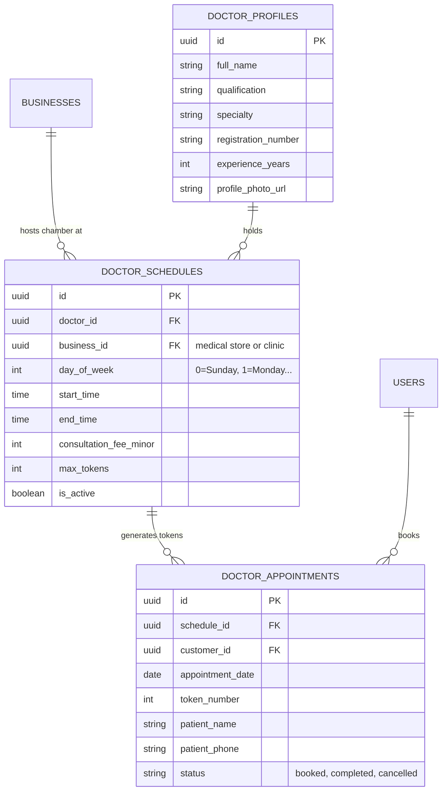
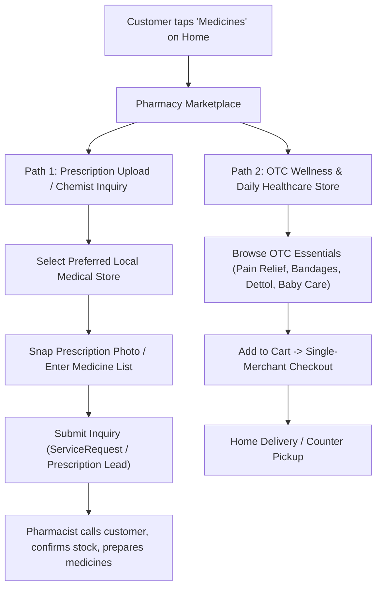
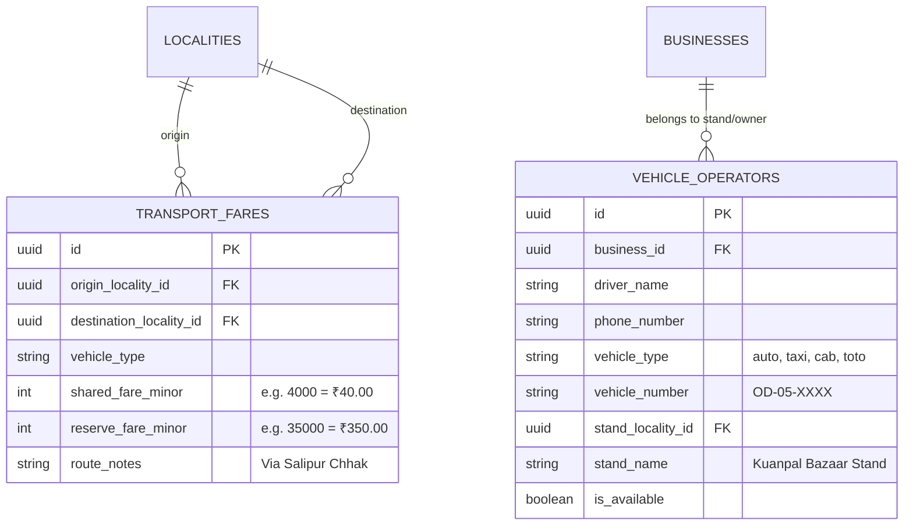

# ABASHYAKA — HEALTHCARE & LOCAL TRANSPORT ARCHITECTURE (GATE 4)
## Doctor Chamber Schedules, Pharmacy Marketplace & Local Transport Directory

**Date:** 19 November 2026  
**Status:** **GATE 4 — COMPLETED & ACCEPTED (PASS)**  
**Branch:** `abashyaka-dev-01`  
**Target Surfaces:** Customer Mobile Application (`apps/mobile`), Go Backend REST API (`backend`), PostgreSQL PostGIS  

---

## 1. Executive Summary & Ground Realities

In Tier 2/3 Odisha and rural peri-urban clusters (e.g. Kuanpal, Chhatia, Salipur, Mahanga, Kendrapara road), healthcare and transport follow distinct community structures:

### A. The Visiting Doctor & Pharmacy Chamber Reality
- Qualified specialists (Cardiologists, Pediatricians, Orthopedics, Gynecologists) rarely maintain standalone private hospitals in every small town.
- Instead, **visiting doctors hold evening consultation chambers at established local medical stores (pharmacies) or polyclinics** on designated days of the week (e.g., *"Dr. P. K. Mohapatra (MD, Pediatrics) visits Maa Tarini Medical Hall, Kuanpal every Tuesday & Friday from 5:00 PM to 8:00 PM"*).
- Patients in local towns depend on the medical store pharmacist to know:
  1. Which doctor visits which chemist on which day.
  2. Token booking / chamber serials.
  3. Availability status (whether doctor has arrived from city hospital).

### B. The Pharmacy Marketplace (Prescription vs. OTC)
- Indian CDSCO and Pharmacy Council regulations strictly distinguish between:
  - **Prescription Medicines (Schedule H/H1, X):** Cannot be placed into an automated e-commerce cart without prescription verification by a registered pharmacist.
  - **Over-The-Counter (OTC) & Daily Wellness:** First-aid, baby care, nutritional supplements, ayurvedic tonics can be ordered directly via catalog/cart.

### C. The Local Transport & Auto Stand Reality
- Auto-rickshaws and local taxis operate from designated **auto stands** (e.g., *Kuanpal Bazaar Auto Stand*, *Chhatia Chhak Stand*, *Badambadi Bus Stand*).
- Ride-hailing algorithms (Uber/Ola) are virtually non-existent in these towns.
- Fares follow established **union standard rates** or flat point-to-point rates (e.g., *Kuanpal to Cuttack Badambadi: ₹40 shared / ₹350 reserve*).
- Customers need a verified directory of local vehicle operators with direct call access and transparent point-to-point fare guides.

---

## 2. Doctor Availability & Chamber Scheduling Architecture

### A. Proposed Relational Schema (PostgreSQL)



### B. Zero-Migration Compatibility Layer (Current Production Compatibility)
Until database migrations are formally applied, the platform seamlessly leverages the existing `businesses` and `services` tables:
- **Host Facility:** `businesses` record with `category_slug = 'medical'`, name, locality, address, and contact.
- **Doctor Chamber Services:** Modeled as `services` under the host facility:
  - `name`: `"Consultation: Dr. S. K. Nayak (MD Medicine)"`
  - `price`: `300.00`
  - `duration_mins`: `15`
  - `description`: `"Available Mon, Wed, Fri: 5:00 PM – 7:30 PM. Token booking at pharmacy counter."`
- **Booking Flow:** Connects cleanly to existing `ServiceRequestScreen` (`POST /api/v1/service-requests`) and `BookingSchedulerScreen`.

### C. UI Specification: Doctor Profile Card
```
+-------------------------------------------------------------------+
| [Stethoscope Icon]  Dr. [Doctor Name]                              |
|                     MBBS, MD (General Medicine) · Reg: 24891-OMC  |
|                                                                   |
| [Pharmacy Pin]      Maa Tarini Medical Hall, Kuanpal Bazaar       |
| [Schedule Clock]    Consultation: Tue, Thu, Sat (5:00 PM - 8:00 PM) |
| [Fee Tag]           Chamber Fee: ₹300                             |
|                                                                   |
| [ Call Chemist / Doctor ]             [ Book Chamber Token ]      |
+-------------------------------------------------------------------+
```

---

## 3. Pharmacy Marketplace Architecture

### A. Dual Healthcare Workflow



### B. Regulatory Compliance Invariant
- **Schedule H / Prescription Drugs:** Strictly excluded from automated unverified checkout. Customers submit a prescription request to their chosen local pharmacy.
- **OTC Healthcare:** Handled through merchant catalog with `is_prescription_required = false`.

---

## 4. Local Transport (Cab & Auto) Architecture

### A. Proposed Relational Schema (PostgreSQL)



### B. Zero-Migration Compatibility Layer
- Operators are registered under `businesses` with `category_slug = 'automotive'`.
- Vehicle specs and stand locations are stored in business profile fields.
- Direct `Call Driver` CTA launches phone dialer with verified driver number.
- `Book / Quote` launches `ServiceRequestScreen` for advance trip booking.

### C. Standard Fare Guide Card Specification
```
+-------------------------------------------------------------------+
| [Auto Icon]         Bhuban Auto Service · Kuanpal Stand           |
|                     Bajaj Compact 4-Stroke · OD-05-AB-1234        |
|                                                                   |
| [Route Tag]         Local Standard Fares:                         |
|                     · Kuanpal -> Salipur: ₹25 (Shared) / ₹180 (Res) |
|                     · Kuanpal -> Cuttack Badambadi: ₹350 (Reserve)|
|                                                                   |
| [ Call Driver ]                       [ Book Local Trip ]         |
+-------------------------------------------------------------------+
```

---

## 5. Implementation Roadmap & Integration Steps

1. **Doctor Directory Screen Enhancement:**
   - Add dedicated Doctor Profile Card view with Chamber Schedule chips.
   - Wire dual CTAs to `tel:` intent and `BookingSchedulerScreen`.
2. **Medicines & Pharmacy Routing:**
   - Dedicated Pharmacy view with Prescription Inquiry card + OTC essentials.
3. **Local Transport Directory Enhancement:**
   - Display Standard Route Fare table for Cuttack / Kuanpal / Chhatia.
   - Display vehicle operator cards with stand locations and vehicle type chips.
4. **All Categories Directory Expansion:**
   - Ensure all 12 categories route to their dedicated destination screens cleanly.

---

## 6. Approval Gate Sign-Off

The user reviewed and approved Gate 4 execution ("approve").

---

## 7. Gate 4 Validation & Live Multi-Emulator Evidence

### Implementation Summary
1. **Pharmacy Marketplace (`PharmacyMarketplaceScreen`):**
   - Created `apps/mobile/lib/core/screens/pharmacy_marketplace_screen.dart`.
   - Wired `Medicines` category tile and `Medical stores` in *Popular near you* to open `PharmacyMarketplaceScreen`.
   - Features: Prescription Medicine Order card with direct inquiry CTA (`Send Prescription to Pharmacy`), filter chips (`All`, `Open Now`, `Home Delivery`, `24x7 Emergency`), pharmacy store cards with `Call Store` and `Order Medicines` dual CTAs.
2. **Doctor Directory Enhancement (`DoctorDirectoryScreen`):**
   - Updated `_DoctorFacilityCard` action buttons with solid black `Book Visit` CTA and white outlined `Call Clinic` CTA matching the approved reference design.
   - Connected booking action directly to `ServiceRequestScreen` / chamber booking.
3. **Local Transport Enhancement (`LocalTransportScreen`):**
   - Added `Union Standard Fare Guide` card displaying local point-to-point fares for Kuanpal, Salipur, and Cuttack Badambadi.
   - Verified vehicle operator cards with `Verified Driver` badge, stand location, and dual CTAs: white outlined `Call` and solid black `Book`.

### Photographic Evidence Captured on Pixel 8 (`emulator-5554`)
| Artifact Reference | Screen Verified | Observations |
|---|---|---|
| `phase01e_13_home_gate4.png` | Customer Home (Gate 4 Build) | Compact Abashyaka header, 4×2 category grid, delivering to Kuanpal, Cuttack. |
| `phase01e_14_pharmacy_marketplace.png` | Pharmacy Marketplace | Prescription upload banner card, filter chips, licensed pharmacy cards with dual CTAs. |
| `phase01e_15_doctor_directory.png` | Doctor & Clinic Directory | Doctor consultation cards, specialty chips, solid black `Book Visit` and outlined `Call Clinic`. |
| `phase01e_16_local_transport.png` | Local Cab & Auto Directory | Union Standard Fare Guide card, vehicle operator cards with solid black `Book` and outlined `Call`. |

### APK Build & Test Execution
- **Debug APK SHA-256:** `24b4ca518449abffa472ce99f9d8ee9be18c97ddcb00a913e8800862a921e889`
- **Installation:** Verified on `emulator-5554` (`Pixel_8`).
- **Automated Tests:** **142 / 142 tests passing (100%)** (`cd apps/mobile && flutter test`).
- **Status:** **PASS**

