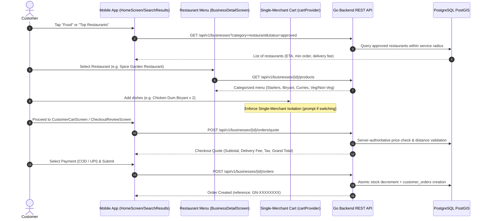
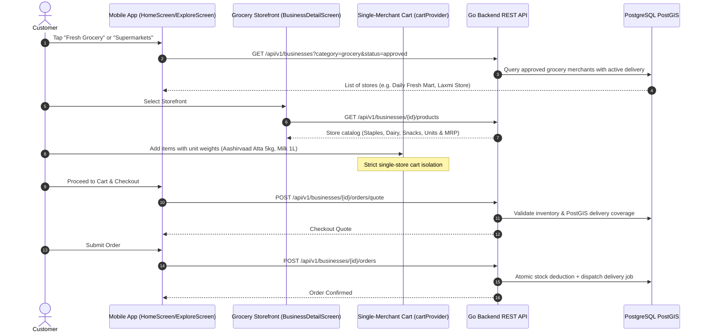
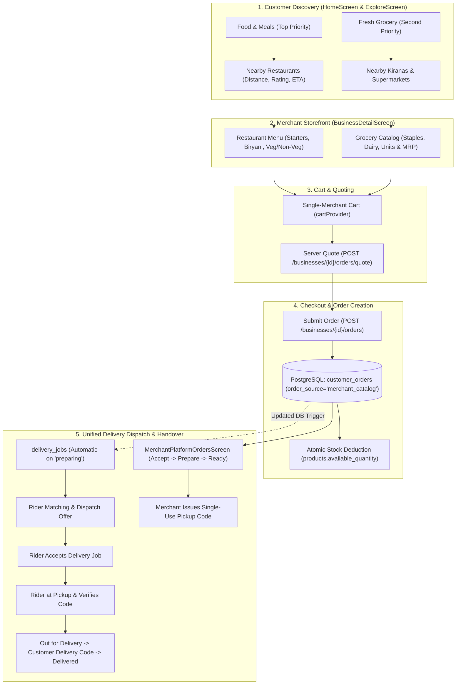

# ABASHYAKA — PHASE 02F ARCHITECTURE & COMPATIBILITY AUDIT
## Merchant-Owned Food & Grocery Commerce Architecture Audit

**Document Reference**: `docs/phases/ABASHYAKA_PHASE_02F_MERCHANT_OWNED_COMMERCE_AUDIT.md`  
**Date**: 19 November 2026  
**Repository**: `D:\grepmind-near`  
**Branch**: `abashyaka-dev-01`  
**Status**: **AUDIT COMPLETE — PROPOSAL PENDING OPERATOR APPROVAL (READ-ONLY)**  
**Role**: Principal Go Commerce Architect, Flutter Architect, PostgreSQL Engineer, and Marketplace Security Reviewer  

---

## 1. Executive Summary & Objective

Abashyaka is preparing to transition from an anonymous platform-fulfilled SKU catalog to a **true local merchant-owned Food and Grocery marketplace**, connecting customers directly with their neighborhood restaurants, cloud kitchens, kirana stores, and specialty supermarkets.

At the same time, the end-to-end commerce lifecycle validated in **Phase 02E** (server-authoritative quoting, atomic row-level stock reservation, payment verification guards, merchant kitchen tickets, HMAC single-use pickup codes, and multi-role rider dispatch) must be preserved with zero regression.

### Scope of Phase 02F
Phase 02F is a **strictly read-only architectural, database, security, and compatibility audit**. No production or shared database schema changes, backend code modifications, or mobile client mutations are authorized or executed during this phase.

---

## 2. Existing Commerce Audit: Model A vs. Model B

The Grepmind Near codebase currently possesses two distinct commerce architectures that operate side-by-side:

```
+-------------------------------------------------------------------------------------------------------------------------+
|                                              COMMERCE ARCHITECTURE COMPARISON                                           |
+--------------------------+---------------------------------------------------+------------------------------------------+
| Dimension                | Model A: Platform-Owned Catalog (Phase 2R / 02E)  | Model B: Merchant-Owned Catalog (Phase 2A) |
+--------------------------+---------------------------------------------------+------------------------------------------+
| Primary Tables           | platform_catalog_products,                        | businesses,                              |
|                          | platform_catalog_variants,                        | products,                                |
|                          | platform_partner_product_mappings                 | business_hours, business_categories      |
| Product Ownership        | Grepmind Platform (Central standardized SKU/bar)  | Individual Local Business / Store Owner  |
| Price Authority          | Platform price revision + partner supply price    | Merchant-set selling price (products.price)|
| Merchant Identity        | Secondary (hidden partner assigned server-side)   | Primary (restaurant / shop front & center|
| Cart Architecture        | platformCartProvider (scoped to locality/vertical)| cartProvider (scoped to businessId)      |
| Quoting Endpoint         | POST /api/v1/platform/orders/quote                | POST /api/v1/businesses/{id}/orders/quote|
| Order Creation           | POST /api/v1/platform/orders                      | POST /api/v1/businesses/{id}/orders      |
| order_source Flag        | 'platform_catalog'                                | 'merchant_catalog'                       |
| order_type Value         | 'platform_order'                                  | 'food_delivery', 'table_reservation', etc|
| Order Items Table        | platform_customer_order_items                     | customer_order_items                     |
| Stock Reservation        | platform_inventory_reservations (held/consumed)   | Direct UPDATE products.available_quantity|
| Fulfillment Pipeline     | platformfulfillment.Service (/platform-orders)    | operations.Service (/merchant/orders)    |
| Rider Dispatch Trigger   | DB Trigger: create_delivery_job_for_platform_prep | NONE (hardcoded to platform_catalog only)|
| Delivery Fee Logic       | Currently 0 / flat in platform quote              | Merchant-configured (businesses.delivery)|
+--------------------------+---------------------------------------------------+------------------------------------------+
```

### Critical Architectural Finding
In the current database trigger (`backend/migrations/026_delivery_jobs_dispatch.sql:110`):
```sql
CREATE OR REPLACE FUNCTION create_delivery_job_for_platform_preparation()
RETURNS trigger LANGUAGE plpgsql AS $$
BEGIN
    IF NEW.order_source <> 'platform_catalog'
       OR NEW.fulfillment_type <> 'delivery'
       OR NEW.status <> 'preparing'
       OR OLD.status = NEW.status THEN
        RETURN NEW;
    END IF;
    ...
```
**Consequence**: Any order created via `POST /api/v1/businesses/{id}/orders` (which has `order_source = 'merchant_catalog'`) is completely ignored by the automated delivery dispatch pipeline! No `delivery_jobs` row is created, no riders are dispatched, and the merchant cannot issue pickup codes through `MerchantPlatformOrdersScreen`.

---

## 3. Required Customer Experience & Screen Layout Hierarchy

### Customer Screen Hierarchy Directive
On the primary Abashyaka consumer discovery surfaces (`HomeScreen` and `ExploreScreen`), local discovery must explicitly prioritize freshly prepared meals before packaged FMCG goods:

```
+-------------------------------------------------------------------------------+
|                      ABASHYAKA CUSTOMER SURFACE HIERARCHY                     |
+-------------------------------------------------------------------------------+
|  1. Locality & Search Header (e.g. Kuanpal, Cuttack / Chhatia, Jajpur)        |
|  2. Promotional Hero Carousel (Local Merchant Spotlight)                      |
|  3. Primary Categories Grid (Food & Dining FIRST, Fresh Grocery SECOND)       |
|                                                                               |
|  [SECTION A: FOOD & MEALS — TOP PRIORITY]                                     |
|  - Nearby Top Restaurants & Cafes (Rating, Distance, Delivery Time)          |
|  - Meal Discovery Strips: Biryani & Rice, Homestyle Thali, Tandoor & Curries  |
|  - Restaurant Menus with Veg/Non-Veg Badges & Preparation Times               |
|                                                                               |
|  [SECTION B: FRESH GROCERY & DAILY ESSENTIALS — SECOND PRIORITY]              |
|  - Neighborhood Kirana & Supermarkets (Daily Fresh Mart, Radha Krishna Store) |
|  - Grocery Category Hubs: Fresh Vegetables, Dairy & Bread, Staples, Snacks    |
|  - Packaged Items with Weights/Units (1 kg, 500 g, 1 L) & MRP discounts       |
|                                                                               |
|  [SECTION C: LOCAL SERVICES & HEALTHCARE — SUPPORTING]                        |
|  - Doctors, Clinics, Pharmacies, Electricians, Plumbers                       |
+-------------------------------------------------------------------------------+
```

### Vertical Interaction Flows

#### A. Food Delivery Flow (100% Merchant-First)


#### B. Grocery Marketplace Flow (Merchant-First Storefronts)


### Single-Merchant Cart Invariant
Under no circumstances may a single customer order contain products from multiple distinct merchant businesses. 
- In `apps/mobile/lib/core/providers/cart_provider.dart`, if `CartState.businessId` differs from the incoming product's `business_id`, the client must reject silent insertion and display an explicit confirmation dialog:
  > *"Replace cart items? Your cart already contains items from [Existing Merchant]. Would you like to clear your cart and start a new order from [New Merchant]?"*

---

## 4. Backend Capability Audit Matrix

Every commerce component across the backend codebase was audited for reusability, limitations, and required adaptations:

| # | Capability Scope | Current Code Location | Status | Audit Findings & Adaptation Requirements |
|---|---|---|---|---|
| **1** | Grocery Category in `ValidateCart` | `backend/internal/operations/service.go:65` | **PARTIAL** | Currently hardcoded: `if !enabled \|\| (category != "restaurant" && category != "cafe")`. Rejection prevents grocery ordering. Requires category allowlist expansion to `grocery`, `supermarket`, `bakery`. |
| **2** | Merchant `delivery_enabled` Rules | `businesses.delivery_enabled`, `min_order_amount` | **VERIFIED** | Enforced in database schema (`008_hospitality.sql`) and queried in `loadQuoteBusiness`. Fully functional. |
| **3** | PostGIS Distance & Coverage Checks | `backend/internal/operations/checkout.go:502` | **VERIFIED** | `deliveryServiceability` uses `ST_DWithin(b.location, ST_SetSRID(ST_MakePoint(lng,lat),4326)::geography, pp.service_radius_m)`. Reusable without change. |
| **4** | Inventory Reservation & Restoration | `backend/internal/operations/service.go:512` vs `platformcommerce/service.go:520` | **PARTIAL** | Model B mutates `products.available_quantity` directly, but lacks a transactional reservation log (`platform_inventory_reservations`) and automatic trigger restoration on order cancellation/rejection. |
| **5** | Price Authority & Quoting | `backend/internal/operations/checkout.go:361` | **VERIFIED** | `CreateCheckoutQuote` calculates server-authoritative line subtotals, delivery fees, and minimum order checks with 5-minute expiry. Fully reusable. |
| **6** | Merchant Order Transitions | `backend/internal/platformfulfillment/service.go:109` | **PARTIAL** | `platformfulfillment.Service` queries `WHERE o.order_source='platform_catalog'`. Orders placed via `POST /businesses/{id}/orders` are invisible to `MerchantPlatformOrdersScreen`. Must be unified. |
| **7** | Payment Eligibility & Verification | `backend/internal/platformfulfillment/payment_gate_test.go` | **REUSABLE** | `paymentEligibleForFulfillment` logic applies cleanly to both COD and UPI sandbox flows. Reusable across both models. |
| **8** | Automated Rider Dispatch | `backend/migrations/026_delivery_jobs_dispatch.sql:110` | **BLOCKED** | Trigger `create_delivery_job_for_platform_preparation` explicitly requires `NEW.order_source = 'platform_catalog'`. Blocks rider assignment for merchant-owned orders. |
| **9** | Merchant Business Isolation | `backend/internal/platformfulfillment/service.go:300` | **VERIFIED** | `canAccessBusiness` and `lockBusinessAccess` verify active ownership or membership in `business_members` with RBAC (`owner`, `manager`, `staff`). Zero cross-store leakage. |
| **10** | Product Publishing & Availability | `backend/cmd/api/main.go:1635`, `products` table | **VERIFIED** | `is_published`, `stock_status`, `inventory_mode` (`finite`/`untracked`), and `business_hours` fully operational. |
| **11** | Order Cancellation & Refunds | `backend/internal/operations/service.go:868`, `backend/internal/payments/refunds.go` | **REUSABLE** | Cancellation endpoints exist. Trigger `customer_orders_cancel_delivery_job` must be broadened to handle merchant orders with delivery jobs. |

---

## 5. Merchant Management Requirements

Within the existing, unified **Merchant Workspace** (`MerchantCatalogScreen` and `MerchantPlatformOrdersScreen`), merchants must experience category-tailored capabilities without creating separate applications or backends:

### A. Restaurant & Cloud Kitchen Merchants (`category_slug = 'restaurant' | 'cafe' | 'bakery'`)
- **Menu Categorization**: Grouping dishes under culinary headings: *Starters*, *Main Course*, *Biryani & Rice*, *Tandoor & Breads*, *Desserts*, *Beverages*.
- **Dietary Indicators**: Mandatory `dietary_type` tags (`veg`, `non_veg`, `egg`, `vegan`).
- **Preparation Parameters**: `preparation_time_min` (e.g. 15, 25, 40 mins) to compute realistic customer ETAs.
- **Cooking Instructions**: Customer notes pass directly onto the kitchen preparation ticket (`_KitchenTicketSheet`).
- **Kitchen Handover**: Real-time status progression (`placed` → `accepted` → `preparing` → `ready_for_pickup` → 8-char pickup code verification with Rider).

### B. Grocery & Kirana Merchants (`category_slug = 'grocery' | 'supermarket'`)
- **Product Classification**: Categories: *Atta & Flours*, *Rice & Dals*, *Oils & Ghee*, *Dairy & Eggs*, *Fresh Vegetables*, *Packaged Foods*, *Household Cleaning*.
- **Units & Weights**: Explicit measurement labels: `1 kg`, `500 g`, `250 g`, `1 L`, `500 ml`, `Pack of 4`, `Piece`.
- **Dual Pricing**: `mrp` (Maximum Retail Price) vs. `selling_price` with automatic discount badge rendering (e.g. *"Save 15%"*).
- **Stock Tracking**: Real-time `available_quantity` with low-stock alerts (< 5 units) and automated `out_of_stock` gating.
- **Picking & Packing**: Order packing checklist before marking `ready_for_pickup`.
- **Out-of-Stock Item Handling**: Partial fulfillment or customer notification prior to acceptance.

---

## 6. Compatibility & Security Constraints

The proposed architecture strictly maintains the following non-negotiable security boundaries:

1. **Platform Catalog Backward Compatibility**:
   - `platform_catalog_products`, `platform_cart`, and existing platform checkout quotes remain completely intact. No legacy platform records or queries are deprecated or dropped.
2. **Immutable Audit Trails & Order IDs**:
   - Existing `customer_orders.id` UUIDs, reference codes (`GN-XXXXXXXX`), and `customer_order_status_events` remain immutable and append-only.
3. **Authentication & Session Preservation**:
   - Customer (`+919990000171`), Merchant (`+919990000172`), and Rider (`+919990000173`) authentication tokens, roles, and device bindings are unchanged.
4. **Server-Authoritative Pricing**:
   - Client prices are treated strictly as display hints. The Go backend recalculates every line item, subtotal, delivery fee, and tax in PostgreSQL transactions.
5. **No Blind Category Allowlists**:
   - Grocery checkout will NOT be enabled by simply relaxing the category check in `ValidateCart`. Enabling grocery checkout requires complete alignment of delivery fee computation, PostGIS coverage checking, stock reservation triggers, and rider delivery jobs.
6. **Payment Security**:
   - Unverified UPI orders remain blocked from merchant acceptance (HTTP 409 `PAYMENT_NOT_VERIFIED`). Plaintext pickup codes are never stored in the database or logs.

---

## 7. Proposed Unified Commerce Architecture

To unite Model A and Model B without duplicate code or competing schemas, the unified architecture introduces **Unified Merchant Fulfillment**:



### Key Technical Innovations in Proposed Design:
1. **Unified Order Fulfillment Pipeline**:
   - Extend `platformfulfillment.Service` queries to fetch orders where `o.order_source IN ('platform_catalog', 'merchant_catalog')` and map `customer_order_items` into the merchant's unified pipeline.
2. **Broadened Delivery Job Trigger**:
   - Modify PostgreSQL trigger `create_delivery_job_for_platform_preparation()` to fire for all orders where `fulfillment_type = 'delivery'` and `status = 'preparing'`, irrespective of `order_source`, provided the business has active delivery coverage.
3. **Product Schema Enhancement**:
   - Add optional grocery columns to `products`: `unit_label` (`kg`, `g`, `L`, `pack`), `mrp` (NUMERIC), and `barcode` (TEXT).

---

## 8. Implementation Milestones (Roadmap Post-Phase 02F)

```
+--------------------------------------------------------------------------------------------------+
|                                  PHASE 02 POST-AUDIT ROADMAP                                     |
+-------------+------------------------------------+-----------------------------------------------+
| Milestone   | Focus Area                         | Deliverables & Gates                          |
+-------------+------------------------------------+-----------------------------------------------+
| Phase 02F   | Architecture & Compatibility Audit | This Document; Read-Only Analysis (Current)   |
| Phase 02G   | Database Schema Unification        | Migration for delivery trigger & product units|
| Phase 02H   | Backend Fulfillment Unification    | Unified order acceptance & pickup code engine |
| Phase 02I   | Mobile Food & Grocery UI Polish    | Food-first Home layout & grocery store views  |
| Phase 02J   | Multi-Emulator E2E Acceptance      | Full 3-Role (Customer/Merchant/Rider) PASS    |
+-------------+------------------------------------+-----------------------------------------------+
```

---

## 9. Comprehensive Test Plan for Implementation

When approved for implementation in subsequent phases, validation must execute against the following test suite:

1. **Unit & Isolation Tests**:
   - `ValidateCart` correctly validates restaurant menus and grocery catalogs while rejecting invalid categories.
   - `CreateCheckoutQuote` enforces minimum order amounts and calculates correct delivery fees based on PostGIS distance.
   - `cartProvider` prevents silent addition of products from multiple businesses.
2. **Database Integrity & Trigger Tests**:
   - Trigger creates `delivery_jobs` row when `customer_orders` transitions to `preparing` for both `order_source = 'merchant_catalog'` and `'platform_catalog'`.
   - Order cancellation atomically cancels open delivery offers and active rider assignments.
   - Stock quantities never fall below 0 under concurrent checkout attempts (`SELECT ... FOR UPDATE`).
3. **Multi-Role Fleet Integration**:
   - Customer (`emulator-5554`): Discovers restaurant, adds dishes, requests quote, and places COD and UPI orders.
   - Merchant (`emulator-5556`): Receives merchant-owned order in `MerchantPlatformOrdersScreen`, accepts, starts prep, marks ready, and generates pickup code.
   - Rider (`emulator-5558`): Receives automated dispatch offer, accepts, verifies pickup code at store, and completes delivery handover.

---

## 10. Final Gate: Operator Approval Request

Phase 02F is complete as a read-only architecture and compatibility audit.

### Decisions Requiring Operator Approval:
1. **Approval of Architecture**: Approve the unified fulfillment approach where `delivery_jobs` and `MerchantPlatformOrdersScreen` handle both merchant-owned orders (`order_source = 'merchant_catalog'`) and legacy platform orders (`'platform_catalog'`).
2. **Approval of Customer Surface Order**: Confirm the visual hierarchy placing **Food & Meals first** (restaurants, bakeries, cafes) and **Fresh Grocery second** (kiranas, supermarkets) on the customer mobile home and explore views.
3. **Authorization to Proceed**: Authorize transition to **Phase 02G (Database Schema & Trigger Unification)** when ready.

*(No code or database modifications have been made during Phase 02F).*
