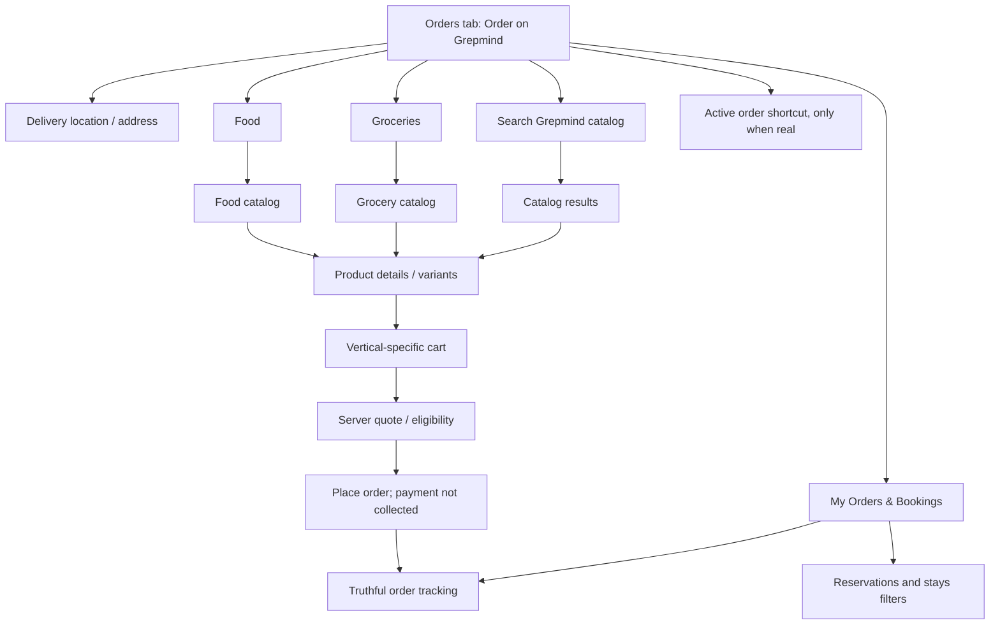
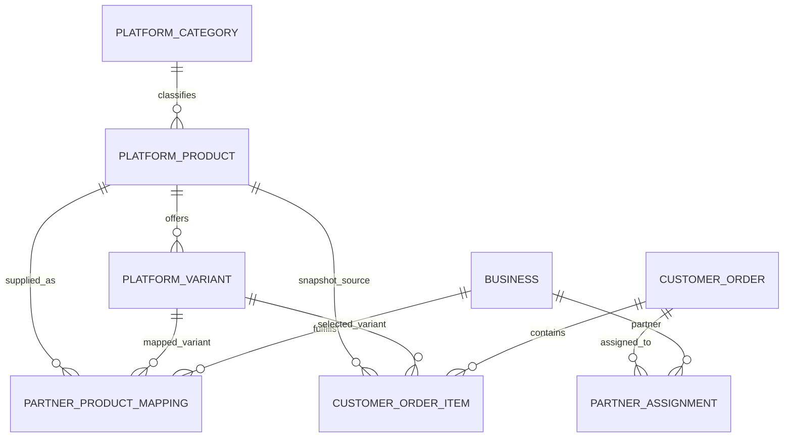
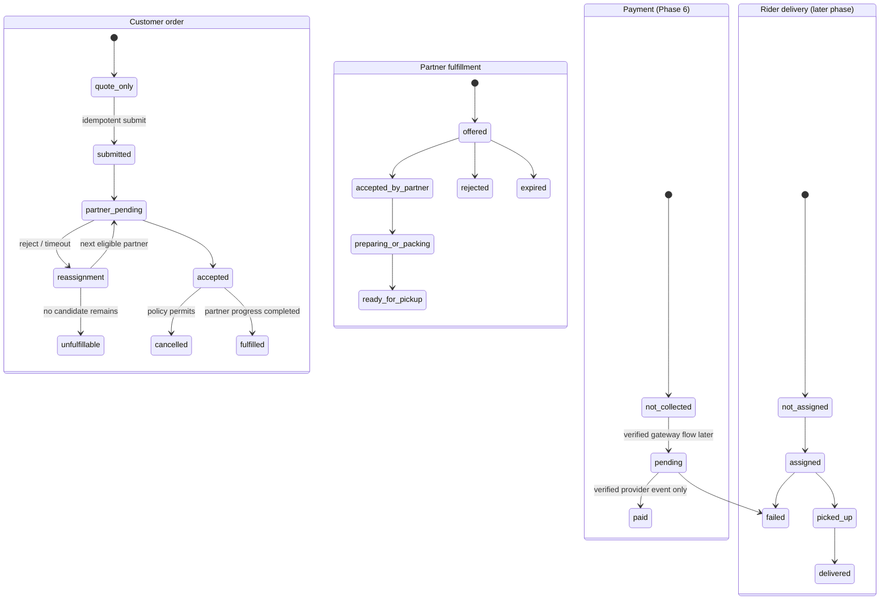

# Phase 2R — Platform catalog and partner-fulfillment architecture correction

**Review date:** 6 November 2026
**Status:** Design review complete; awaiting product-owner approval.
**Scope:** Source inspection and architecture proposal only. No application/API source, OpenAPI, migration, or runtime configuration was changed for this review.

## Executive decision

Adopt a **Grepmind-owned customer catalog with local-partner fulfillment** for the next customer-commerce architecture. Grepmind controls customer-facing product identity, availability policy, and selling price. Customers select products from the Grepmind catalog; they do not have to select a restaurant or shop first. The Go backend selects one eligible partner for the complete order. Local business discovery, restaurant reservations, hotel stays, and professional-service booking remain separate experiences.

The existing Phase 2B/2C implementation is real, but it implements the earlier merchant-menu model: carts and checkout quotes are keyed to a merchant `business_id`, and order lines reference merchant-owned `products`. Phase 2D order history/tracking code also exists in the current worktree and has been tested for that order model. The pasted prompt's statement that Phase 2D has not started is therefore stale for this checkout. This correction does not erase those records or claim the new platform model is implemented. Preserve the current implementation as a compatibility path while designing and then migrating the customer commerce entry point.

**Recommendation for launch:** maintain distinct Food and Grocery carts/checkout contexts. Do not mix verticals in one cart until the backend has an explicit, approved partner capability proving one partner can fulfill the complete mixed basket. Never silently split a customer's order across partners.

## 1. Current architecture versus corrected architecture

| Concern | Current implementation (verified) | Corrected target |
|---|---|---|
| Customer selection | Opens a business profile/menu; cart requires that business | Starts in Orders → Grepmind catalog; partner is selected server-side |
| Catalog ownership | `products.business_id` is required; merchant APIs create/update/delete catalog records | Platform catalog records are owned/approved by Grepmind; partner mappings describe supply, capacity, and availability |
| Cart identity | Flutter cart persists `business_id`; it rejects another merchant's items | Cart is keyed by customer and commerce vertical, with platform product/variant IDs; no required customer-facing partner ID |
| Quote | `POST /businesses/{id}/orders/quote`; quote stores `business_id` | Quote validates platform items, address/area, one-partner fulfillability, platform prices, and quote expiry |
| Order lines | `customer_order_items.product_id` references merchant `products` | One existing order model with immutable platform item/variant/price snapshots and an optional fulfillment partner assignment |
| Fulfillment | The chosen business is the seller/fulfiller at checkout | A mapped, approved partner accepts one Grepmind order; Grepmind coordinates future shared delivery |
| Operations portals | Merchant catalog CRUD can set merchant item price; admin has listing/KYC/offers/report operations, but no verified platform catalog management module | Admin owns platform catalog/price and partner mapping governance; merchants manage partner opt-in, supply stock/capacity, and assigned fulfillment |
| Orders tab | Customer order history and bookings | Shopping hub with catalog entry, search, cart, active-order shortcut, and separate “My Orders & Bookings” destination |

Evidence: `backend/migrations/001_core_schema.sql` makes `products.business_id` non-null; migration 011 makes both `customer_orders.business_id` and `customer_order_items.product_id` required. `apps/mobile/lib/core/providers/cart_provider.dart` stores `businessId`, validates through `/businesses/{id}/cart/validate`, and rejects cross-business cart lines. `checkout.go` creates quotes for a business. Flutter checkout passes `businessId` to `/businesses/{id}/orders/quote`. Merchant product CRUD is routed at `/merchant/products`. Current order APIs in `backend/cmd/api/main.go` retain the existing customer and merchant status paths. Admin routes inspected cover business moderation, reports, offers, access, and metrics; no platform-product catalog routes were found. The existing `backend/cmd/worker/main.go` is a lifecycle stub, not an assignment job runner.

Relevant existing code includes `apps/mobile/lib/core/screens/business_detail_screen.dart`, `customer_cart_screen.dart`, `checkout_review_screen.dart`, `order_history_screen.dart`, `order_tracking_screen.dart`; `backend/internal/operations/{service.go,checkout.go}`; `backend/internal/discovery/service.go`; merchant catalog in `apps/merchant-web/components/CatalogManager.tsx` and mobile `merchant_catalog_screen.dart`; admin screens under `apps/admin-web/app` and `components`.

## 2. Reuse / extend / new component matrix

| Area | Reuse | Extend | New work after approval |
|---|---|---|---|
| Customer navigation | Phase 1 five-tab shell; Home, Explore, Nearby, Profile | Orders tab becomes a hub; keep its history destination | Orders hub, Food catalog, Grocery catalog, search/detail routes |
| Existing discovery | Business search/detail, saved businesses, category capabilities, reservations, hotels, service requests | Remove the commerce requirement to select a restaurant; preserve booking CTAs and APIs | None for discovery itself |
| Cart | Riverpod state/lifecycle, persistence/error patterns, quantity controls | Replace merchant-scoped identity with vertical + platform item/variant ID; separate Food/Grocery carts | Platform catalog line model and migration-safe persistence version |
| Pricing/checkout | Customer addresses, quote expiry, idempotency, integer minor-unit arithmetic, transactional submission | Quote must resolve partner eligibility and platform selling price; stock belongs to partner mapping | Platform catalog price/revision and fulfillment quote contracts |
| Orders | `customer_orders`, `customer_order_items`, exact customer ownership, cancellation/history, event timeline | Support platform order origin and nullable/unselected partner assignment; retain old merchant orders | Partner assignment/offer records and separate fulfillment/delivery states |
| Partner supply | Merchant business/branch, membership RBAC, coverage/hours, inventory controls | Merchant cannot alter platform selling price; expose mapped products and assigned Grepmind orders | Partner-product mapping, stock/capacity and acceptance workflow |
| Admin | Existing authentication, root protections, audit log, moderation layout | Reuse admin design system and audit service | Platform catalog, variants/prices, partner mappings and exception workspaces |
| Events | Existing authenticated SSE hub and notifications | Publish order/assignment transitions with customer/business scopes | Assignment timeout processing using existing worker after it is upgraded; no new broker |

Do not change historical migrations 001–020. The next schema work starts at migration 021 or the next number confirmed from the repository at implementation time.

## 3. Customer navigation and screen map

Orders hub design: address/locality selector; catalog search; accessible cart badge; Food and Grocery entry cards; other verticals only when explicitly enabled; featured products/offers only from live, approved data; real active-order status; and “My Orders & Bookings.” Food and Grocery share reusable components but launch as separate carts. “Popular” requires actual ranking evidence; otherwise omit it or label content as curated with an auditable admin source. Empty, unavailable, offline, and location-required states must not invent products, prices, ratings, availability, orders, ETAs, or partner capacity.

Home/Explore/Nearby continue local discovery. Business profiles may retain reservations, hotel booking, service requests, calling, and informational menus where appropriate. A restaurant menu is no longer a prerequisite for ordering from the Grepmind catalog; the existing merchant-specific food ordering path must remain clearly identified as legacy/compatibility until its use is decided, not silently presented as the new platform catalog.

## 4. Proposed catalog domain

The names below are conceptual; final table naming and normalization belong in Phase 2R.1 migration design.

**Platform product:** stable UUID, SKU, name, description, category/subcategory, image/media references, active state, city/locality availability, fulfillment requirements, tax classification, created/updated actor, and revision.
**Variant:** stable variant/SKU, display name, unit/quantity, option data, and platform selling price in integer minor units plus currency and effective revision. Do not mix customer selling price with partner supply/settlement cost.
**Partner mapping:** business/branch, platform variant, enabled/approved mapping state, partner SKU if required, finite or untracked inventory/capacity, preparation/packing constraints, hours/coverage eligibility, and audited supply terms kept separate from public price.
**Availability:** explicit city/locality/coverage and active windows; do not infer stock from a merchant's old `stock_status` without migration and verification.
**Order snapshot:** preserve item name, variant, unit, customer price, currency, tax classification, quantity, and catalog revision at submission. Historical receipts must not change when catalog prices or labels change.

The existing `products` table remains the merchant-owned catalog for legacy business listings and services. Do not repurpose it into a global catalog or copy every merchant product into a platform product automatically. Use explicit mapping and admin review.

## 5. Cart and checkout contracts (proposal)

Contracts below are design targets, not implemented or approved API changes. Keep relative `/api/v1` for portals.

| Operation | Proposed purpose |
|---|---|
| `GET /commerce/catalog/categories?vertical=food\|grocery&city=...` | Return active, location-available categories and subcategories |
| `GET /commerce/catalog/products?vertical=...&category=...&q=...&cursor=...` | Bounded, cursor-paginated catalog search; only active products/prices and honest stock state |
| `GET /commerce/catalog/products/{id}` | Product details, variants, units, live eligibility, media and selling price |
| `POST /customer/checkout/quote` | Accept address ID, vertical, platform item/variant IDs and quantities; derive all prices and partner capability server-side; return expiring quote, itemized price, availability and whether one partner can fulfill the complete basket. Never accept a client-selected partner or trusted total. |
| `POST /customer/orders` | Accept quote ID and idempotency key; revalidate quote, address, current price, mapping, coverage, hours, and stock/capacity; atomically reserve one candidate partner's inventory and create/replay the order. |
| `GET /customer/orders` and `GET /customer/orders/{id}` | Extend existing owned order resources; return platform snapshots, partner acceptance state without disclosing unnecessary partner-private data, event timeline, and separate payment/delivery state. |
| `GET /merchant/fulfillment/orders` | List only assignments for member-authorized `business_id` branches |
| `POST /merchant/fulfillment/orders/{id}/accept` / `reject` | Atomic, idempotent partner decision scoped to the authorized branch |
| `PATCH /merchant/fulfillment/orders/{id}/progress` | Allowed preparation/packing/ready transitions; server-side state machine |
| Admin catalog/mapping APIs | Root/admin-authorized catalog and partner mapping CRUD, audit records, approval and deactivation |

Do not simply rename `/businesses/{id}/orders/quote`: the customer must not supply the partner identity. Existing `/businesses/{id}/cart/validate`, `/businesses/{id}/orders/quote`, and legacy merchant product-order routes remain compatible during migration, but the new Orders hub uses the platform contracts only after the approved slice is fully testable.

## 6. Partner eligibility and assignment algorithm

For every quote/order, derive candidates by set intersection: each candidate must be an approved active merchant branch with an explicit active mapping for **every** requested platform variant. Filter candidates by available quantity/preparation capacity, current operating schedule, coverage of the selected address, required delivery capability, and whether the partner is accepting work. Never treat proximity alone as eligibility.

For MVP, rank only eligible single-partner candidates deterministically using: serviceability/required capability; sufficient inventory/capacity; operational availability; distance from partner to delivery point (when coordinates are available and permitted); measurable accepted-work load; then stable business UUID as tie-break. If coordinates are absent, use configured city/locality coverage rather than pretending to know distance. Do not expose private settlement terms or partner ranking internals to customers.

Quote is read-only and reserves nothing. At submit, use a transaction, idempotency lock/unique key, locked platform price revision, locked partner mapping/inventory rows, and one selected partner. Reserve from at most one partner at a time. Record an expiring partner offer. On rejection or timeout, release that reservation before selecting the next candidate. If all candidates fail, release all holds, mark the order as unable to fulfill/cancelled with an honest reason, notify the customer, and collect no payment. Do not silently split an order.

The Compose worker currently exists but `backend/cmd/worker/main.go` only starts/stops; it is not an assignment processor. Phase 2R.4 must either add a bounded DB-backed assignment-expiry/retry loop to that existing worker or explicitly choose another process within the current modular-monolith/Compose architecture. Do not add Redis, a message broker, microservices, or Kubernetes. Keep a durable audit record of candidate, offer, decision, reservation, timeout, and release.

## 7. Order and lifecycle separation

Keep four distinct lifecycles. Do not overload one status field with payment or rider events.

Suggested states require owner approval and reconciliation with legacy state constraints. Keep existing `customer_orders.status` and `customer_order_status_events` functioning for legacy orders. Add a separate partner-assignment status/event record and delivery lifecycle when needed. Payment stays `not_collected` through this roadmap until Phase 6 provider verification. Rider assignment, GPS, delivery OTP, and FCM remain deferred to their approved rider phase.

## 8. Proposed additive database change plan

Do not modify migrations 001–020. Start at the next confirmed sequential number after inspecting the repository.

1. **Catalog foundation (2R.1):** platform categories, products, variants, selling-price revisions/effective state, city/locality availability, admin audit linkage, partner-product mapping, mapping status, and partner stock/capacity. Add constraints/indexes for unique SKU, mapping uniqueness, nonnegative money/quantity, and valid active windows.
2. **Order compatibility (2R.3/2R.4):** add an explicit order source/model discriminator. Preserve existing `business_id` values for legacy selected-business orders. For platform orders, introduce separate nullable fulfillment partner linkage/assignment rather than putting platform catalog ownership in `business_id`. Before allowing `business_id` to be null, enumerate all readers, handlers, indexes, and reports; use a checked constraint distinguishing legacy/platform rows. Keep new order lines in the existing table with mutually exclusive nullable legacy `product_id` and platform variant ID plus immutable snapshots. Do not delete or rewrite historic rows.
3. **Fulfillment:** partner assignment/offer rows with unique active assignment per order, attempt number, deadline, state, actor, reason, reservation linkage, and timestamps; separate delivery fields/table only when Phase 4 is approved.
4. **Inventory reservations:** reservation rows or an equivalent constrained ledger with unique order/partner/item keys and release/consume state. Lock partner mappings or inventory rows in a consistent order. Make release/consume idempotent and transactionally tied to order cancellation/acceptance.
5. **Backfill:** no automatic assumption that current merchant products are Grepmind catalog items. Admin-approved explicit mappings only. Existing orders remain unchanged and queryable.
6. Test both clean database setup and upgrade from the current locally applied 001–020 state on disposable PostgreSQL/PostGIS. Historical migrations 005/008 have already documented clean-chain fixture prerequisites; do not “fix” them in this design task.

## 9. Merchant, admin, and rider impacts

### Merchant

Keep Merchant tabs: Dashboard, Orders, Catalog, Earnings, Profile. The partner Catalog view becomes **Mapped Grepmind items / availability**, not global customer price editing. Merchants can request mapping/opt in, set stock or preparation capacity, and accept assigned orders. Existing merchant-owned catalog CRUD remains for local discovery and legacy supported operations. Preserve branch/member `business_id` isolation and existing owner/manager/staff rules. Earnings remain unavailable until real settlement data exists.

### Admin

Reuse admin authentication, root superadmin protections, audit logs, portal shell/design system, and existing merchant registry/KYC tools. Plan later panels for platform catalog/products/variants/prices, mapping approvals, partner coverage/capability, assignment exceptions, and order dispute oversight. Existing Admin currently has no verified platform catalog APIs/UI; its business moderation and merchant catalog are not a substitute. Every price, mapping, approval, deactivation, and exception decision must record actor, before/after values, and reason.

### Rider

Rider Mode stays role-gated. Partner acceptance and rider assignment are distinct. No rider onboarding, dispatch, GPS, OTP, FCM, or earnings implementation in 2R/2R.1–2R.4. Future rider delivery begins only after an accepted and ready partner fulfillment assignment.

## 10. Security, RBAC, concurrency, and compatibility

- Admin catalog writes: authenticated admin policy, root protections where applicable, audit history, bounded uploads/fields, validation, and no client-trusted actor or price revision.
- Merchant mappings/stock/orders: every read/write derives membership from the authenticated user and scopes `business_id`; merchant may mutate only its own mapping/capacity and assigned fulfillment, never Grepmind selling price or another branch's order.
- Customer carts, quotes, orders, cancellations, and events: authenticated customer ownership; 404 for another user's order/address/quote where needed; cart line IDs and totals are revalidated server-side.
- Catalog and price changes: quote binds user, vertical, address revision, product variant, quantities, price revision, and expiry. Submit checks the same revision and returns explicit changed-price/unavailable details; no silent repricing.
- Stock contention: transaction plus ordered row locks/reservation ledger, bounds on cart/item/quantity, no oversell, release on reject/timeout/cancel, and idempotent order/partner decisions.
- SSE: authenticated customer stream limited to owned order IDs and partner streams limited to authorized business IDs; close on account/workspace change; never include full addresses or settlement terms in events.
- Privacy: retain minimal delivery-address precision and redact address/coordinates from logs and analytics. Product availability may be location-aware but must not expose the user's precise location to unrelated partners.
- Backward compatibility: legacy `/businesses/{id}/...` APIs and restaurant bookings continue while the platform flow is rolled out. Deprecate only after measured use and explicit migration/compatibility approval. Never make `customer_orders.business_id` nullable without auditing every legacy query/portal report first.
- Do not claim performance results from design. Use cursor-paginated catalog/search, indexes for active vertical/category/city and partner mapping joins, batch line reads, and record actual p95/load measurements during later acceptance.

## 11. Phase roadmap and gates

| Phase | Scope | Exit criteria / approval gate |
|---|---|---|
| **2R — Architecture correction (this review)** | Record platform-owned catalog/partner model and corrected roadmap | Owner approves model, cart vertical policy, order compatibility strategy, and open decisions. No source changes before approval. |
| **2R.1 — Catalog foundation** | Admin-managed categories/products/variants/prices, city availability, explicit partner mappings, partner stock/capacity | Migration upgrade/fresh tests; Admin RBAC/audit; merchant mapping isolation; catalog API contract tests; no customer storefront yet. Stop for review. |
| **2R.2 — Customer Orders hub** | Orders tab as catalog/home hub; Food/Grocery entry, product search/detail, separate carts | Real catalog only; product/price/stock validation; 19-category discovery and bookings regressions; UI tests/emulator. Stop for review. |
| **2R.3 — Platform checkout adaptation** | Customer addresses and quote reused; platform items, partner candidate check, authoritative prices, idempotent order creation | Single-partner complete-basket eligibility; no reserve on quote; atomic one-partner reservation on submit; no payment; legacy orders unaffected. Stop for review. |
| **2R.4 — Partner fulfillment** | Merchant assigned-order inbox, accept/reject, prepare/pack/ready, timeout/reassignment and reservation release | RBAC isolation, retry/race/timeout coverage, SSE scoping, Admin exception visibility, no split order. Stop for review. |
| **2D — Tracking alignment** | Adapt already-present history/tracking to platform order + partner events while retaining booking history and legacy orders | Customer exact-ID ownership, truthful partner timeline, cancel/reorder/support, no fictional rider data; run device test with disposable eligible order. Stop for review. |
| **2E — Cross-platform acceptance** | Full customer → platform catalog → one partner → order tracking across Flutter, Go/Postgres, merchant/admin portals | Automated and emulator/browser E2E, migration rollback/upgrade plan, authorization matrix, cleanup proof, performance measurements, no real payments. Stop for approval. |

### Acceptance criteria by slice

- **2R.1:** admin create/edit/deactivate platform product/variant and price; audit actor; partner mapping approval; two businesses cannot read/write each other's mapping; city availability enforced; schema works on disposable clean and upgrade DBs.
- **2R.2:** Orders hub, food/grocery browse/search/details, separate vertical carts, restore after restart, no fake “popular”; unsupported vertical unavailable; existing Explore/Nearby/bookings/Saved remain unchanged.
- **2R.3:** address ownership and serviceability; quote is server-derived and non-reserving; displayed minor-unit breakdown matches server; changed price/stock/coverage errors are actionable; duplicate request returns original order; concurrent last stock cannot oversell; payment remains not collected.
- **2R.4:** only assigned partner members can accept/reject/update; one partner supplies all items; reject/timeout releases reservation before next partner; duplicate acceptance is idempotent; exhaustion yields truthful cancellation without payment; scoped SSE reconnects and disposes.
- **2D/2E:** customer/merchant/admin see consistent order/event records; old booking records remain accessible; exact ID never falls back to another order; status history does not fabricate pre-migration events; emulator and portals validate populated disposable data and cleanup.

## 12. Decisions requiring product-owner approval

1. Approve Grepmind-owned catalog and server-selected partner as the customer-commerce model.
2. Approve separate Food and Grocery carts for MVP; mixed vertical cart stays disabled until an explicit one-partner capability is configured and approved.
3. Define who creates/reviews product content and photos, who approves partner mappings, and whether partner mapping begins via request or admin assignment.
4. Confirm launch verticals and scope: Food/Grocery only or other catalog categories later; “other enabled categories” must remain disabled until rules exist.
5. Define city rollout and locality coverage (current focus Cuttack/Jajpur) and how map-pinned vs manually entered addresses are matched.
6. Approve partner order response SLA, offer timeout, retry count, reassignment policy, customer messaging, and final failure behavior.
7. Approve merchant stock semantics, substitutions (initially recommend no substitution without customer consent), out-of-stock handling, and preparation capacity.
8. Decide whether platform retail selling prices are tax-inclusive and obtain qualified India GST/accounting review; keep partner supply price/settlement economics separate. Do not set a rate in code based on this document.
9. Confirm whether existing restaurant-specific food delivery remains available as a separately labeled legacy option during platform rollout and when it can be retired.
10. Approve the compatibility shape for `customer_orders.business_id` and existing order-item foreign keys only after implementation audits every reader; this document proposes a discriminator and separate fulfillment partner field, not immediate nullability changes.
11. Define catalog offer ownership, customer review/rating policy, refunds/payment resolution (gateway remains Phase 6), and support ownership; do not fabricate these workflows.

## 13. Files inspected and current worktree note

Reviewed the supplied `AGENTS.md`, `docs/phases/README.md`, Phase 1, Phase 2A/2B/2C/2D records, `codex-implementation.md`, current `final-architecture.md` worktree diff, Flutter navigation/cart/checkout/order screens/providers, Go route registration and operations/checkout services, migrations 001/011/018/019/020, and current merchant/admin portal catalog/operations files.

The worktree contains many unrelated and earlier Phase 1/2B/2C/2D modifications and untracked QA injection files. `final-architecture.md` has an existing unrelated user edit (an extra blank line at EOF); it was deliberately not changed. This design review does not revert, stage, or commit any worktree changes. No application tests were run for this documentation-only review.

## Approval gate

**STATUS: DESIGN REVIEW COMPLETE — AWAITING APPROVAL**

Do not implement 2R.1, change Phase 2D source, add migrations/API endpoints, or start partner assignment until the product owner approves the architecture and resolves the required decisions above.
