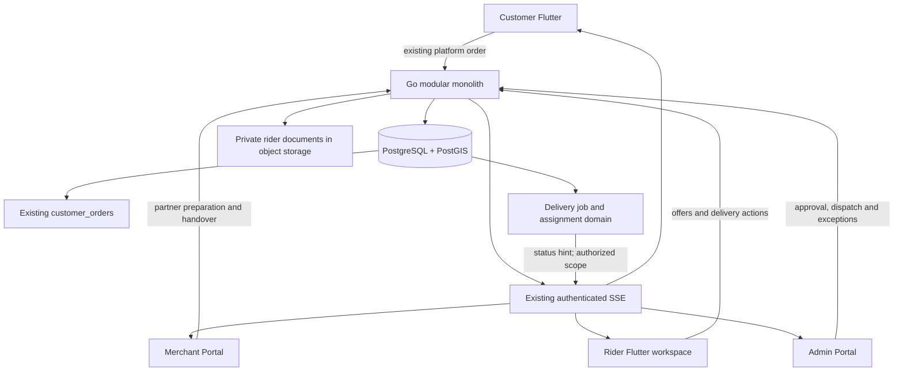
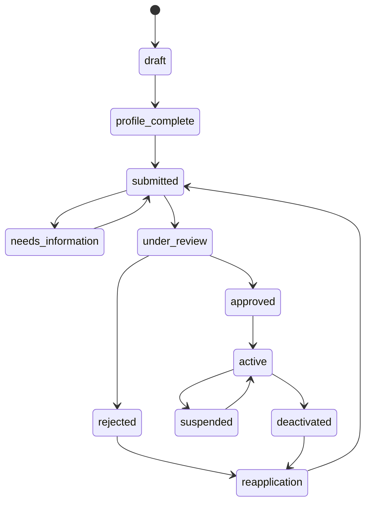
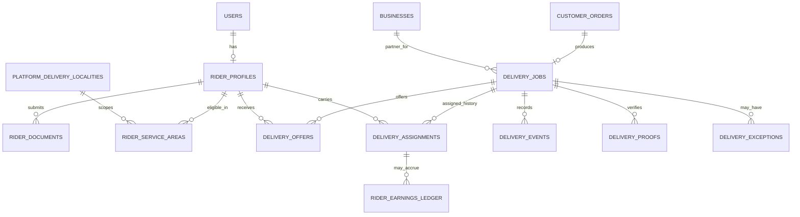
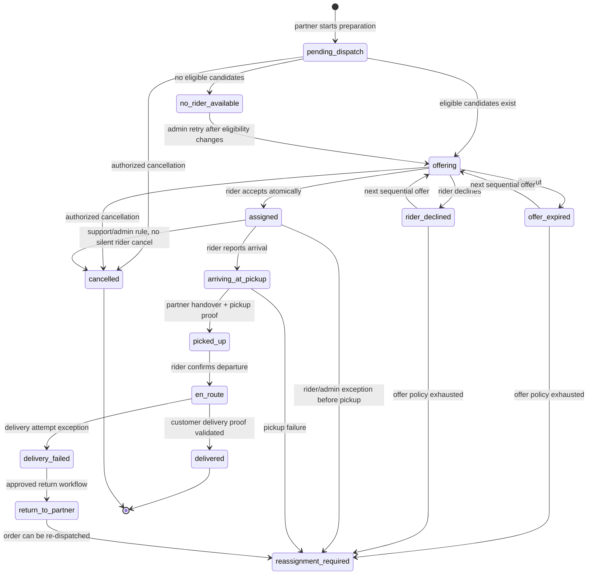
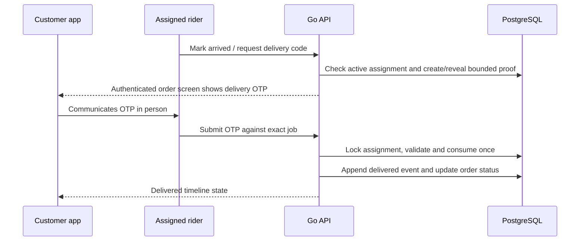

# Phase 3A — Rider & Delivery Architecture Design

**Review date:** 7 November 2026

**Status:** Design review accepted — Phase 3B authorized

**Scope:** Repository audit and architecture documentation only. No application code, migrations, database records, services, or SDK configuration were changed.

## 1. Executive summary

Grepmind has a working platform-owned Food/Grocery order flow through partner preparation and `ready_for_pickup`. The repository has a Flutter Rider workspace shell, a backend `rider` role, locality IDs, partner locality coverage, order status events, and SSE infrastructure. It does **not** have rider applications, rider profiles, verification records, dispatch jobs/offers, assignments, pickup/delivery confirmation, rider location ingestion, or rider earnings.

The recommended MVP is a single Flutter app and the existing Go modular monolith, backed by additive PostgreSQL/PostGIS tables. It starts only in **Cuttack → Kuanpal** and **Jajpur → Chhatia**. Jagatpur, Tangi, and Chandikhol remain planned and unavailable. Admin controls dispatch, with deterministic server-generated recommendations and manual override. Dispatch begins when partner preparation starts. One rider may hold at most one active delivery. Delivery status is authoritative first; live GPS, payments, batching, and payouts remain deferred.

The rider role currently acts as a broad workspace gate. Phase 3B must make rider access depend on a backend rider profile/application in an approved and active state; a client role selection or a bare role row must not prove onboarding or delivery eligibility. Actual delivery operations must also wait for a decision on how an order whose payment state is `not_collected` is funded or otherwise authorized for fulfillment. That state must never be treated as cash-on-delivery by inference.

## 2. Repository audit and current state

### 2.1 Audit boundary and worktree

The checkout is on `development-02`; the latest inspected commits include the phase-history documentation commit and unified navigation work. At audit start, `git status --short` showed extensive pre-existing modifications and untracked Phase 2, catalog, commerce, portal, mobile, and QA files. Those changes were not staged, reverted, or included in this design. This document, the phase index, and the implementation log are the only intended edits from Phase 3A.

The Phase 2E report is the current acceptance record. It reports a same-order Pixel 8 → live Merchant Portal → Pixel 8 tracking verification and disposable QA cleanup. This design does not repeat that runtime run or represent it as newly executed.

### 2.2 Existing functionality to reuse

| Area | Verified source-level foundation | Boundary |
|---|---|---|
| Mobile roles | `apps/mobile/lib/core/screens/role_selection_screen.dart`, `core/providers/app_provider.dart`, and `main.dart` support backend-refreshed Customer, Merchant, Admin, and Rider workspaces. A Rider workspace shell exists. | Rider tabs are placeholders; a role is not an approved rider profile. |
| Admin roles | `backend/internal/moderation/service.go`, `backend/cmd/api/main.go`, and `api/openapi.yaml` support protected user role replacement. Rider role assignment is restricted to the primary superadmin and revokes sessions. | Current role assignment does not create or verify rider onboarding data. |
| Commerce order | `backend/internal/platformcommerce/service.go` creates a platform order, chooses one explicit eligible partner, validates locality/product mapping/stock, and stores order/item snapshots and reservations. | No delivery job is created. |
| Partner preparation | `backend/internal/platformfulfillment/service.go` scopes platform-order reads/actions to the assigned business and active membership; transitions are transactional and events append-only. | Its supported fulfillment path ends at `ready_for_pickup`; a partner cannot assign a rider. |
| Customer timeline | `backend/internal/operations/service.go`, `customer_orders`, `customer_order_status_events`, and the Flutter history/tracking screens provide exact order reads and a manual refresh path. | The Phase 2E report explicitly does not claim SSE delivery during its final device check. Delivery should not be folded into the partner state machine. |
| Geography | Migration 022 defines stable district/locality IDs and separate product visibility, product delivery locality, and partner delivery locality mappings. Kuanpal and Chhatia are enabled; Jagatpur, Tangi, and Chandikhol are configured disabled. | Rider-to-locality eligibility does not exist yet. Use the IDs; do not authorize by name text. |
| Geo points | Core business locations and optional customer address points use PostGIS geography. | A customer point is optional; do not require precise GPS for locality-based serviceability. |
| Notifications | `backend/internal/notifications/hub.go` provides SSE and persisted in-app notifications; the API checks user, business-membership, or service-request scope before subscribing. Nginx is configured for streaming. | There is no rider/delivery event scope or FCM. New streams need assignment-aware authorization and must not accept caller-selected arbitrary user IDs. |
| Browser portals | Existing relative `/api/v1` portal routing, Admin user controls/audit patterns, and Merchant platform-order workflow are reusable. | No rider onboarding, dispatch board, handover, or rider-specific permissions exist. |
| Media | Existing media upload/storage code supports MinIO for development. | Rider verification documents need a private, non-public object policy and authorized download flow, unlike public listing images. |

### 2.3 Missing functionality

Source inspection found no `/api/v1/rider/...` route registration in `backend/cmd/api/main.go` and no rider domain package or rider/delivery migration among migrations 001–024. `api/openapi.yaml` documents Rider as an assignable role, while explicitly noting this role alone does not provision dispatch or tracking. No rider-specific DB tables, delivery job, offer, assignment, proof, exception, location, or earnings ledger exist. The Flutter Rider dashboard, Deliveries, Map, and Earnings pages are explicit placeholders. No actual Admin or Merchant rider workflow exists.

### 2.4 Compatibility and migration status

The latest repository acceptance records state that migrations 023 and 024 passed isolated QA but were not applied to the shared development database. This was not rechecked against a live database during Phase 3A; treat it as the last recorded state, not a current database query. No migration was applied for this design.

Compose mounts `backend/migrations` into PostgreSQL's `/docker-entrypoint-initdb.d`. The repository audit has not found a runtime version ledger/upgrade runner; init scripts only execute automatically for a newly initialized data directory. Future migrations must be additive and sequential, and the existing deployment/backup procedure must be confirmed before applying them to any persistent environment. Do not infer a database's migration state from the checked-in filenames.

Compatibility requirements:

- Keep `customer_orders` as the customer commerce/order identity and reference it from a one-to-one delivery job; do not create a competing delivery order.
- Keep partner fulfillment (`placed`, `accepted`, `preparing`, `ready_for_pickup`, rejection/cancellation) independent from delivery state and payment state.
- Preserve existing merchant `business_id` isolation, customer ownership, the primary superadmin guard, root account protection, and existing SSE configuration.
- Do not amend historical migrations; implementation phases should add the next sequential migrations only after inspecting the actual target database.

## 3. Product model and operating assumptions

Grepmind owns the customer catalog, order acceptance, partner eligibility, dispatch controls, and delivery coordination. One approved partner fulfills the entire order; one assigned rider carries it. Food and Grocery stay separate carts. Delivery runs only in explicitly enabled stable localities. A partner's `ready_for_pickup` is not proof that a rider has collected the order.

Initial rollout is limited to Cuttack/Kuanpal and Jajpur/Chhatia. Existing locality records for Jagatpur, Tangi, and Chandikhol are planned, not live. District catalog visibility, product locality availability, partner coverage, rider locality eligibility, and delivery-zone coverage are separate checks.

`payment_status=not_collected` means no customer payment has been recorded. It does not mean COD, an authorization to dispatch, or a rider collection obligation. Before live deliveries, the product owner must approve who bears the unpaid-order risk and what operational signal makes an order dispatchable. QA/test orders can be explicitly marked as test-only in their isolated environment.

## 4. Recommended MVP architecture

Use the existing boundaries:

- **Flutter:** one application with a backend-authorized Rider mode and the planned Dashboard | Deliveries | Map | Earnings | Profile shell.
- **Go:** rider onboarding, dispatch, delivery state, authorization, and audit modules inside the existing modular monolith. Keep business rules in services and use transactions for state changes.
- **PostgreSQL/PostGIS:** rider/profile/verification, service area, availability, delivery job/offer/assignment/event and proof metadata. Use PostGIS only for actual spatial ranking or future zone geometry; stable locality IDs establish eligibility.
- **Admin Portal:** review/approve/suspend riders, manage service areas, inspect unassigned work, recommend/override assignment, and resolve exceptions with audit trails.
- **Merchant Portal:** see the assigned rider and handover status for orders assigned to that business; confirm handover or report an exception. No arbitrary rider assignment or delivery completion.
- **SSE:** use persisted delivery events as truth and SSE as an update signal. Re-fetch authoritative state after reconnect. Do not claim push/background delivery from SSE.
- **Storage:** rider KYC objects must be private and accessed through short-lived, authorized server-mediated downloads. Do not use public MinIO object URLs for KYC.

No Redis, message broker, microservices, external dispatch platform, or map-routing API is justified for the pilot. A transactional outbox may be introduced if delivery event publication must survive process crashes; it can live in PostgreSQL and the existing worker/runtime, rather than requiring new infrastructure.



## 5. Rider onboarding and approval

### 5.1 Lifecycle and authorization



Document review statuses should distinguish `pending`, `accepted`, `rejected`, `expired`, and `superseded`; an expiry must block new activation/availability until the required replacement is reviewed. Reminders should be sent without exposing document contents in notification payloads.

The distinct concepts are:

1. **Registered:** user has an application record.
2. **Verified:** required checks/documents have current reviewed outcomes.
3. **Approved:** an authorized reviewer approved the application and applicable agreements.
4. **Active:** account is not suspended/deactivated, required documents are current, and rider role/access is still valid.
5. **Available:** rider has explicitly opted online, has a current availability session/heartbeat, meets service-area/vehicle constraints, and has no active delivery.
6. **Assigned:** a committed delivery assignment exists for this rider and job.

Only the backend can derive these states. Client role selection is a presentation preference. Sensitive actions must re-check current approval, suspension, session, role, offer/assignment ownership, and relevant document validity on every request. A role revocation must invalidate privileged mode/session according to existing role-change behavior.

Phase 3B should replace the bare-role-only approval interpretation with an application/profile approval gate. The primary superadmin remains protected; routine KYC review should be permissioned to a narrowly scoped reviewer/admin capability, with separation between review and high-impact role administration where feasible. No merchant member may inspect rider KYC.

### 5.2 Minimal data and document review

Collect only fields necessary to contact the rider, operate in assigned localities, verify identity/vehicle eligibility, manage emergency/safety processes, and handle compensation records if later approved. A proposed onboarding packet:

- User link and verified phone from existing OTP account.
- Display/legal name and minimum contact details.
- Vehicle class and details only when relevant to the chosen delivery method.
- Applicable identity/licence/vehicle evidence and expiry dates, held privately.
- Service locality IDs, preferred language, and acceptance of rider agreement.
- Reviewer, decision, reason code, timestamps, document check result, and audit references.
- Emergency contact only if operations/legal review demonstrates a need and defines access and deletion.

Do not collect Aadhaar copies by default; do not presume a single licence/registration rule covers bicycle, two-wheeler, or other vehicle types. Obtain India/Odisha legal advice on vehicle class, insurance, worker classification, police verification, medical/fitness checks, written terms, social-security obligations, and licensing applicability before onboarding real riders. The current Motor Vehicles Aggregator Guidelines include driver onboarding requirements; counsel must determine their applicability to Grepmind's goods-delivery model and any Odisha/state rules. The DPDP Act and 2025 Rules also require a reviewed privacy notice, purpose limitation, safeguards, retention and data-principal request workflow. These are design flags, not a finding of legal compliance.

Keep original KYC files separated from ordinary profile data. Store object key, media type, byte size, checksum, uploader, document type, expiry, review status, reviewer and audit timestamps. Do not persist public URLs. Use private buckets, least-privilege access, time-limited download authorization, encryption in transit/at rest where supported, malware/type validation, access logging, and deletion/retention jobs. Define exact retention periods with counsel before production use.

## 6. Rider mobile UX specification

All screens are driven by API state with loading, empty, offline, error/retry, revoked-access, and success states. Do not display fabricated delivery counts, earnings, ratings, locations, routes, or ETAs.

| Tab | MVP design and actions | Important states |
|---|---|---|
| Dashboard | Approval/status banner; explicit Online/Offline control; current assigned job card; locality and safe operational alerts. Show counts only from an API response. | Pending approval, suspended, offline, online/no jobs, assigned, network stale. |
| Deliveries | Current offer with expiry countdown from server time, partner/locality, order-safe item summary and accept/decline; active delivery actions permitted by state; history. | No offers, expired/withdrawn offer, another rider won, no network, active assignment. |
| Map | Initially pickup/drop-off address summaries and “Open in maps” handoff using authorized order data. No live map until a separately approved GPS design. | Location permission denied, no point/address, stale route destination, external map unavailable. |
| Earnings | Phase 3F: ledger-backed completed delivery, pending payable, adjustment and dispute rows; no payouts until settlement is implemented. | Empty ledger, pending calculation, no payout functionality. |
| Profile | Verification/document status, approved localities, vehicle details, privacy notice, availability and sign out. | Expired document, re-review, access suspended. |

Design with Material 3, the app's existing design tokens, 48dp touch targets, screen-reader labels, text scaling, clear safety confirmations, and no mandatory map/GPS permission merely to view job status. Going offline or signing out during an active delivery must explain the effect and follow an approved policy; never silently abandon an active assignment.

## 7. Delivery data model (proposed, not implemented)

Reuse `users`, `user_roles`, `businesses`, `business_members`, `customer_orders`, `platform_delivery_localities`, `platform_partner_delivery_localities`, `customer_addresses`, existing audit records, and existing platform order items. Proposed additions should be introduced in sequential additive migrations, likely beginning after 024 **only after the target DB migration state is inspected**.

| Candidate entity | Purpose / important data | Constraints and boundary |
|---|---|---|
| `rider_profiles` | One rider identity per user; onboarding status, activation/suspension, vehicle class, language, reviewer timestamps. | Unique user FK; state checks; no client-writable approval; soft deactivation for audit. |
| `rider_documents` | Private object metadata, document type, expiry, verification decision and reviewer. | No public URL; object key private; strict access; append review history or immutable review events. |
| `rider_service_areas` | Rider eligibility per stable locality ID, approval/active flag. | FK to `platform_delivery_localities`; no locality-name authorization. Future zones can be a child mapping. |
| `rider_availability_sessions` | Online/offline session, device/session id, heartbeat, current availability and last transition. | One current session per rider/device policy; server timestamps; stale heartbeat means unavailable. |
| `delivery_jobs` | One job per eligible platform `customer_orders` row; partner, locality, current delivery state and version. | Unique order FK; only platform delivery orders; partner must equal order business; immutable identity. |
| `delivery_offers` | Rider-specific offer, expiry, response, sequence and dispatch attempt. | Unique job/attempt/rider as appropriate; only one outstanding offer per job in MVP; server-clock expiry. |
| `delivery_assignments` | Accepted assignment, rider, job, assignment/release times and actor. | Partial unique active assignment per job and per rider; DB-enforced one active delivery per rider. Reassignment closes prior assignment atomically. |
| `delivery_events` | Append-only state/audit timeline with actor type/id, transition, reason, server time and safe metadata. | No update/delete except privileged retention operations; exclude secrets, full GPS, and unnecessary PII. |
| `delivery_proofs` | Pickup/delivery verification hashes, expiry, attempt counters, consumption and verification actor. | Store token hash only; one-time consumption and lockout; do not include token in ordinary event payloads/logs. |
| `delivery_exceptions` | Structured failed pickup/drop-off, unreachable recipient, damage/safety, support disposition and evidence references. | Scoped to job/assignment; reason required; safe status and resolution audit. |
| `rider_latest_locations` (future GPS) | Latest active-trip coordinate, accuracy, captured/received times. | One row per rider; access only for current assigned job and approved support. No home/idle tracking. |
| `rider_location_history` (future GPS) | Short-lived diagnostic/route samples only if approved. | Separate retention/deletion policy; partitioning only if measured volume warrants it. |
| `rider_earnings_ledger` (Phase 3F) | Immutable accrual/debit/adjustment entries linked to completed job and rule version. | Integer minor units; no negative/duplicate accrual; payout state separate and disabled. |

Use UUID FKs, explicit CHECK constraints, bounded JSON metadata, UTC server timestamps, indexes for `(state, locality_id, created_at)`, outstanding offers by rider/job/expiry, and partial unique indexes for active assignments. Avoid storing duplicate customer contact/address fields in delivery rows; read the order's immutable address snapshot through authorized service logic and return only fields needed for the actor's task.



## 8. Independent state machines and customer timeline

### 8.1 Delivery states

Recommended state set:

`pending_dispatch → offering → assigned → arriving_at_pickup → picked_up → en_route → delivered`

Exception/recovery states: `offer_expired`, `rider_declined`, `no_rider_available`, `pickup_failed`, `customer_unreachable`, `delivery_failed`, `reassignment_required`, `return_to_partner`, `cancelled`. Some are dispatch/job outcomes rather than delivery terminal states; model attempt outcomes as events/exception codes where keeping the main job active is necessary for retry.



Transitions are server-authoritative, row-locked/version checked, and idempotent by command key. A replay returns the prior outcome; a different competing transition receives a documented conflict and must not duplicate inventory release, proof consumption, rider earnings, or events.

### 8.2 Actor and transition summary

| Transition | Actor | Preconditions / evidence | Atomic effects |
|---|---|---|---|
| Create pending dispatch | System on partner `preparing` event | Platform delivery order, locality enabled, order still eligible under approved unpaid-order policy | Insert one job; append event; outbox/notification after commit. |
| Offer rider | Dispatch service/admin | Approved active rider, active locality, eligible vehicle, online/fresh session, no active assignment | Insert expiring offer; lock/version job; notify only that rider. |
| Accept offer | Offered rider only | Own unexpired outstanding offer; profile remains active; no active job; job unassigned | Atomically claim one job and rider; invalidate competing offers; append event. |
| Decline | Offered rider | Own unexpired offer, with optional reason code | Close offer; append event; schedule/recommend next candidate. |
| Arrived / pickup | Assigned rider and assigned partner | Job assignment active; partner order is `ready_for_pickup`; correct order token/handover | Record arrival; verify token once; mark delivery `picked_up`; update customer-order summary to `out_for_delivery`. |
| En route | Assigned rider | Pickup verified and not previously completed | Append event; reveal customer delivery verification only as policy allows. |
| Delivered | Assigned rider with customer proof; support override separately | Active assignment; valid unexpired one-time customer code or approved alternative evidence | Consume proof; mark delivery complete and order `delivered`; append events; release assignment; create ledger accrual only if Phase 3F rules enabled. |
| Exception/reassign | Rider reports; Admin/support resolves | Active job/assignment; structured reason; any policy-required evidence | Keep history; release/reassign atomically; notify scoped parties; never silently lose order. |

### 8.3 Separate lifecycle dimensions and customer projection

Keep four dimensions independent:

| Dimension | Source of truth | Example values |
|---|---|---|
| Customer order | `customer_orders` | placed, accepted, preparing, ready_for_pickup, out_for_delivery, delivered, cancelled |
| Partner fulfillment | Existing partner status/events | placed, accepted, preparing, ready_for_pickup, rejected |
| Rider delivery | Proposed `delivery_jobs`/`delivery_events` | pending_dispatch through delivered plus exception attempts |
| Payment | Existing payment status | not_collected, pending, paid, failed |

Customer timeline projection: partner accepted/preparing/ready events remain as today; “Rider search started” only after a delivery job exists; “Rider assigned” only after committed assignment; “Picked up” only after verified handover; “Out for delivery” only after pickup; “Delivered” only after delivery proof. `ready_for_pickup` must not imply rider assigned, pickup, ETA, or payment. Never project a failed dispatch as a completed/delivered order.

## 9. Dispatch and assignment algorithm

### 9.1 Recommendation

Use **hybrid dispatch**: deterministic backend recommendation and sequential rider offer, with an Admin override that records actor/reason. Start searching when the partner moves the order to `preparing`, so rider travel can overlap preparation. Keep one outstanding offer per job in the MVP to avoid offer races; on decline/expiry, close the offer transactionally and offer the next candidate. Pilot default timeout: **60 seconds, configurable**, with an Admin-controlled retry/exhaustion path. This is an operating recommendation requiring approval.

### 9.2 Eligibility before ranking

Candidates must all satisfy:

1. A currently approved/active rider profile and current rider authorization.
2. Rider availability explicitly online with a non-stale server heartbeat.
3. Enabled stable locality ID matching the job and an active rider-service-area grant.
4. Vehicle capability for order/package class if the business later adopts such classifications.
5. No active delivery assignment (MVP concurrency limit is one).
6. No active suspension, expired required document, revoked role, or conflicting assignment.

Eligibility is a hard filter. **Distance alone never establishes eligibility.**

### 9.3 Deterministic ranking and fallback

First apply locality, status, availability, active-job, and vehicle filters in SQL. Rank eligible candidates by: (a) fresh, consented pickup proximity if a valid coordinate is already available; otherwise do not manufacture a distance; (b) fewest recent offers/declines subject to a fairness window; (c) longest continuously available; then rider UUID as stable tie-break. Any weighting/fairness window needs operational approval and should be configurable, not hardcoded business policy. Use PostGIS `ST_Distance` for candidate ranking only with a clear freshness/accuracy threshold; do not call it an ETA or route distance.

If no candidates qualify, set a visible `no_rider_available`/unassigned dispatch status, alert the dispatch board, and leave the customer order truthfully ready/waiting according to approved policy. Do not invent ETA, assign a fake rider, or silently cancel. Admin may re-run search, widen only to explicitly approved neighboring coverage, contact a rider, or escalate to customer/partner support. Cross-locality fallback is disabled by default.

Concurrency: lock the job when creating/closing an offer; lock both job and rider availability row when accepting; rely on DB partial unique indexes as final protection for one active job/rider; same offer acceptance is idempotent; competing acceptance gets a conflict. Admin override uses the same transaction and constraints as rider acceptance.

## 10. Pickup and delivery verification

### 10.1 Pickup — recommended MVP

Use **rider-entered short-lived pickup OTP plus partner confirmation**:

- Generate cryptographically random digits server-side only when a rider is assigned and pickup can proceed (recommend code creation after partner marks order ready, to reduce exposure).
- Store a keyed/hash representation, expiry, attempt count, assignment ID, and consumed timestamp. Never log or include the secret in customer API, SSE, analytics, crash reports, or event history.
- Show the code only to authorized active members of the assigned partner for that order; rider submits it only for their active assignment. Do not show it to unrelated merchants or any rider other than the assigned one.
- Short validity (recommend 10 minutes after issuance), bounded attempts (recommend 5), one-time use, constant-time hash compare where applicable, lockout/backoff, invalidate on reassignment/cancel, and wrong-order protection.
- Successful verification and partner handover confirmation atomically mark `picked_up` and add immutable events. Reaching pickup coordinates is not evidence.
- Offline fallback is not a client-side bypass. A documented support/admin override needs strong authentication, reason, evidence, and audit; determine whether dual approval is required.

### 10.2 Delivery — recommended MVP

Use a **customer-visible delivery OTP** as primary proof, with support-managed exception handling:

- Generate a fresh random code only when the job is picked up/en route or when the recipient is approached, not at checkout.
- Display it to the authenticated customer for that exact order and only during the delivery window; the customer communicates it to the rider. Keep it out of push preview and merchant views.
- Store only a hash, bind it to job/assignment/order, expire it, rate-limit attempts, consume it once, and invalidate on reassignment.
- Mark delivered only in the same transaction that validates the current assignment and consumes the code. GPS alone, a rider UI tap, or an expired/replayed code is insufficient.
- If customer is unreachable, rider records an attempt/exception, contacts support, and follows an approved wait/contact/return policy. No false delivery completion. Photo proof is deferred to minimize sensitive image collection.
- Support override requires reason and evidence; approval/dual-control threshold remains an open operations decision.

```mermaid
sequenceDiagram
  participant P as Assigned partner
  participant API as Go API
  participant DB as PostgreSQL
  participant R as Assigned rider
  P->>API: Show pickup code for ready order
  API->>DB: Read active job/assignment and token state
  API-->>P: Short-lived code (authorized partner only)
  R->>API: Submit code for assigned job
  API->>DB: Lock job, verify hash/expiry/attempts, consume once
  API->>DB: Append pickup event; update order projection
  API-->>R: Pickup verified
  API-->>P: Handover confirmed
```



## 11. Location, coverage, and privacy

### 11.1 Rollout geography

| District | Locality | Current catalog/delivery setup | Rider availability in this design |
|---|---|---|---|
| Cuttack | Kuanpal | Delivery enabled in migration 022 | Proposed initial pilot; enable rider coverage only through approved operations configuration. |
| Jajpur | Chhatia | Delivery enabled in migration 022 | Proposed initial pilot; enable rider coverage only through approved operations configuration. |
| Cuttack | Jagatpur | Configured; delivery disabled | Planned; cannot dispatch. |
| Cuttack | Tangi | Configured; delivery disabled | Planned; cannot dispatch. |
| Jajpur | Chandikhol | Configured; delivery disabled | Planned; cannot dispatch. |

Eligibility should require all applicable records: active district/locality, delivery enabled, order locality, partner coverage and rider service-area approval. Future polygons/pincodes should be child coverage zones tied to a locality; they must not invalidate existing locality IDs. Admin activation must be auditable. For first pilot, locality service area is sufficient; do not promise a polygon-grade boundary.

### 11.2 Status-first MVP and future GPS

**MVP:** status timeline only, no continuous rider coordinates and no live-map promise. Rider can navigate by explicitly handing off authorized partner/customer address information to a maps app, subject to access policy. If address coordinates are absent, show the text address and a missing-pin state.

**Later GPS:** separate consent and capability. Android background location is not required for status-only operation. If approved later, track only while an active assigned delivery needs it; explain purpose before OS permission, use foreground service/notification when background collection is justified, stop immediately on delivered/cancelled/reassigned/logout/revocation, cap and adapt update rate, validate timestamp/accuracy/jump plausibility server-side, and return a stale state rather than a fabricated current point. Denied permission means status delivery continues; dispatch policy may still operate without GPS if approved, but customer map remains unavailable.

Customer location access must be limited to the customer's own exact order/current assigned rider. Rider sees only their current assignment's required pickup/drop-off details. Partner sees assigned job and handover state, not unrelated trips or rider KYC. Support/admin access is role-scoped and audited. Do not expose idle/home location. Persisted location history is not needed for MVP. Set exact retention periods after privacy/legal review; implement deletion/aggregation and audit access before enabling GPS.

The DPDP Act and notified 2025 Rules are relevant to notices, purposes, security safeguards, processors, retention and data-principal rights; production policy and effective-date applicability need counsel/privacy review. Primary references: [Digital Personal Data Protection Act, 2023 — India Code](https://www.indiacode.nic.in/indiacode/handle/123456789/22037?view_type=browse) and [Digital Personal Data Protection Rules, 2025 — MeitY](https://www.meity.gov.in/documents/act-and-policies/digital-personal-data-protection-rules-2025-gDOxUjMtQWa?pageTitle=Digital-Personal-Data-Protection-Rules-2025).

## 12. Delivery fees, rider earnings, and settlement

Keep these as separate money concepts and records:

1. Customer delivery charge in the server quote/order snapshot.
2. Partner settlement/supply basis (already private in platform mapping).
3. Rider earning accrued for completed work.
4. Grepmind gross margin/revenue and provider cost.
5. Customer collection/payment state.
6. Rider payout/settlement state.

Do not equate these amounts. Use integer INR minor units, versioned configurable rate policies, immutable entries and correction entries (not edits). Potential policy inputs include locality, package/order type, distance band only if measured safely, waiting, failed pickup, return, cancellation actor, and support adjustment. No price/earning amounts or rates are proposed as defaults in this design. No real UPI, customer collection, cash handling, or rider payout is implemented.

Rider earnings should accrue only from a verified completed delivery under an approved versioned policy. Failed-delivery compensation and manual adjustment need explicit rules and double-entry/audit treatment. Phase 3F may show ledger accrual and pending settlement; it must label payout as unavailable until payout infrastructure and authorization are implemented.

## 13. Admin Portal design

Add a role-guarded Delivery Operations area with:

- Rider applications queue and detail; document review with purpose-limited access; approve/reject/request-information with reason and audit.
- Rider registry with profile/verification/availability status, service localities, document-expiry alerts, suspension/reactivation history.
- Locality configuration for only enabled IDs and planned/active labels.
- Dispatch board: unassigned/offer/assigned/pickup/en-route/exception status; filter by locality, partner, age/state; safe refresh and no fake map position.
- Recommended eligible riders with eligibility reasons and data freshness; manual assignment only from the eligible set; explicit reason and actor logging on override.
- Exception queue and support actions, including reassignment/return/override under permission and evidence policy.
- Delivery history and phase 3F ledger/reporting, without fabricated earnings or payout amounts.
- Audit view showing actor, prior/new state, reason, job/order references, timestamps and authorization result; never show OTP hashes or secret values.

Suggested permission separation: `rider_reviewer`, `dispatch_operator`, `delivery_support`, and `delivery_finance_viewer` capabilities or equivalent scoped admin permissions. Existing `admin`/primary-superadmin controls remain. Do not expose rider KYC to all ordinary admins by default; restrict access and audit document viewing. Role/API names are proposals, not current repository features.

## 14. Merchant Portal integration

Merchant can view the same assigned platform order it already fulfills, plus a minimal rider handover panel: dispatch status, assigned rider display name/vehicle descriptor where justified, arrival status, pickup code when order ready and rider assignment active, handover confirmation, and report-exception action. Restrict every query by assigned `business_id` and membership. Do not display customer contact/address unless the existing operational policy requires a minimum field, and then reveal only while active fulfillment with audit/privacy controls.

Merchant cannot select or assign arbitrary riders; search rider registry; see another business's deliveries; see rider identity documents, personal home/current off-duty location, or earnings; change Grepmind price/fees; change rider compensation; consume rider OTP; or mark `delivered`. The rider verifies pickup; partner confirms handover; only the assigned rider with valid customer proof can complete delivery, subject to audited support override.

## 15. Proposed API contract outline (not added to OpenAPI)

All routes use `/api/v1`, bearer authentication, bounded pagination, request validation, documented error envelopes and server-authoritative state. Names are proposals; OpenAPI changes belong to implementation phases.

| Method and path | Actor / scope | Request → response summary | Key validation and errors | Idempotency / audit |
|---|---|---|---|---|
| `POST /rider/applications` | Authenticated applicant; authenticated subject owns application | `{profile_fields, vehicle_class, locality_ids, agreement_version}` → `{application_id, status, requirements[]}` | Required fields, supported active locality IDs, bounded submission rate; `400`, `409` if an active application exists. | Idempotency key for create; application submitted event. |
| `GET /rider/application` | Applicant only | No body → own application, requirements, document statuses | `404` if none; never return reviewer-only notes or object URLs. | Read access may be audited for sensitive documents, not every ordinary profile read. |
| `PATCH /rider/application` | Applicant only, editable states | Editable profile fields → updated application state | Reject server-owned status/reviewer/approval fields; `409` once locked for review. | Append field/status audit without copying document values into logs. |
| `POST /rider/applications/{id}/documents` | Owning applicant | Multipart document/type/expiry → opaque document ID/status | Ownership, allowed type, byte/MIME bounds, expiry format, malware scan; `413`, `415`, `422`. | Upload is idempotent by upload token; audit object key and actor, not content. |
| `GET /admin/rider-applications` | Rider reviewer | Filters/cursor → paginated redacted review queue | Bounded page/filter; `403` outside reviewer scope. | Reviewer queue access audited at appropriate granularity. |
| `GET /admin/rider-applications/{id}` | Rider reviewer | No body → application and authorized document metadata/download handles | Exact permission; private short-lived download; privacy-safe `404`. | Log document-view grant and reviewer. |
| `POST /admin/rider-applications/{id}/decision` | Rider reviewer | `{decision: approve\|reject\|needs_information, reason_code, note, checklist, version}` → status/effective access | Check reviewer permission, evidence checklist, current version; `409` stale decision, `422` incomplete/invalid checklist. | Idempotency key; immutable decision event. Approval provisions rider capability only after all checks; reject/request-info does not. |
| `POST /admin/riders/{id}/suspend` | Authorized rider admin | `{reason_code, note, active_job_resolution}` → suspended profile | Require reason; define active job handling, do not silently cancel; `409` unresolved assignment. | Idempotent command; revoke rider capability/session and audit. |
| `POST /admin/riders/{id}/reactivate` | Authorized rider admin/reviewer as approved | `{reason, checklist_version}` → active or blocked status | Recheck current documents, role, areas and bans; `409` requirements incomplete. | Idempotent; immutable decision and session/access audit. |
| `PUT /admin/riders/{id}/service-areas` | Scoped operations/admin | `{locality_ids[]}` → approved locality grants | Stable IDs only; reject disabled localities; `422` invalid rollout; `403` wrong scope. | Idempotent replacement; before/after grant audit. |
| `POST /rider/availability` | Approved active rider, current session | `{state: online\|offline, session_id}` → `{state, server_time, active_delivery?}` | Reject suspended/expired docs; offline transition with active delivery follows policy; heartbeat freshness server-controlled. | Idempotent by session/command; availability event. |
| `GET /rider/deliveries/offers` | Approved rider | Cursor → only own unexpired offers, server expiry | Bounded page; stale profile/session returns `403`. | Read only; no arbitrary rider ID. |
| `POST /rider/delivery-offers/{id}/accept` | Rider named by offer | `{command_id}` → assignment/job status | Verify offer unexpired/current, profile active, no competing job; `409 OFFER_EXPIRED` or `ALREADY_ASSIGNED`. | Required idempotency; lock job+rider; append accepted/assignment events. |
| `POST /rider/delivery-offers/{id}/decline` | Rider named by offer | `{command_id, reason_code?}` → offer closed | Verify own current offer; `409` if already resolved/expired. | Idempotent; append reason-coded event, never reveal other candidates. |
| `GET /rider/deliveries/active` | Approved rider | No body → zero/one active assigned job and minimal task data | Enforce one-job invariant and current assignment. | Read only; exact user scope. |
| `POST /admin/delivery-jobs/{id}/dispatch` | Dispatch operator | `{mode: recommend\|assign, rider_id?, reason, version}` → eligible recommendations/offer/assignment | Validate job state, rider eligibility, enabled locality; `409` conflict, `422` ineligible, `403` wrong permission. | Idempotent; all manual overrides include actor/reason and immutable audit. |
| `POST /rider/delivery-jobs/{id}/arrived` | Current assigned rider | `{command_id, observed_at?}` → updated job state | Server time is authoritative; validate assignment; GPS optional and not proof. | Idempotent; append arrival event. |
| `POST /merchant/businesses/{businessId}/delivery-jobs/{jobId}/handover-code` | Active member of the assigned business | `{}` → one-time display response `{code, expires_at}` | Job/order partner match, ready state, active rider assignment; `403/404`, `409` otherwise. | No code in logs/SSE/audit; issuance metadata audited, rate-limited. |
| `POST /rider/delivery-jobs/{id}/pickup` | Current assigned rider | `{command_id, code}` → picked-up status | Exact job+assignment, partner handover, TTL, attempts, replay check; generic `422` invalid proof, `429` limited. | Required idempotency; lock and consume code once; append events/update order summary transactionally. |
| `POST /rider/delivery-jobs/{id}/en-route` | Current assigned rider | `{command_id}` → en-route state | Must be picked up; invalid transition `409`. | Idempotent; append event and update customer projection. |
| `GET /customer/orders/{orderId}/delivery` | Customer who owns the exact order | No body → order-safe delivery state/events, optional assigned-rider display fields | Ownership + delivery order; privacy-safe `404`; no unrelated location. | Read only; audit support/admin access rather than normal customer reads. |
| `POST /customer/orders/{orderId}/delivery-proof` | Customer who owns order | `{action: reveal\|rotate}` → code + expiry during allowed window | Exact active assignment and approved window; rate-limit; `409` outside delivery window. | No code in notifications/logs; hashed proof and reveal event audited. |
| `POST /rider/delivery-jobs/{id}/complete` | Current assigned rider | `{command_id, customer_code}` → delivered state | Exact active assignment, valid unexpired unused proof; `409` invalid state, `422` invalid code, `429` too many attempts. | Required idempotency; proof consumption, delivery/order events, assignment close in one transaction. |
| `POST /rider/delivery-jobs/{id}/exceptions` | Current assigned rider | `{command_id, type, reason_code, note?}` → exception/next allowed state | Bounded enums/text; job ownership; no client-supplied terminal status. | Idempotent; append exception and actor/time. |
| `POST /admin/delivery-jobs/{id}/resolve-exception` | Delivery support/operator with matching permission | `{resolution, reason, evidence_refs[], version}` → resolved job/assignment state | Valid resolution, actor scope, current version, required evidence/second approval policy; `409/422`. | Idempotency; immutable resolution and override audit. |
| `GET /rider/earnings` | Approved rider | Cursor/date range → own ledger entries and totals | Phase 3F only; bounded date range; no payout claim. | Read only; never accepts a target user ID. |
| `GET /admin/delivery-jobs` | Dispatch/support admin | Locality/state/age filters + cursor → paginated board summaries | Role scope, bounded page; redact KYC/address fields by default. | Sensitive detail access audited. |
| `GET /events?delivery_job_id={id}` | Owning customer, assigned rider/partner, permitted support | No body → SSE events for exact authorized job | Authorize exact order/assignment at connect and reconnect; disconnect/revoke on role/assignment change. | Event sequence and snapshot reconciliation; no caller-selected arbitrary `user_id`. |

Expected error classes include `401 UNAUTHORIZED`, `403 FORBIDDEN`, privacy-safe `404 NOT_FOUND`, `409 STATE_CONFLICT` / `OFFER_EXPIRED` / `ALREADY_ASSIGNED`, `422 VALIDATION_ERROR` / `LOCALITY_UNAVAILABLE`, `429 RATE_LIMITED`, and retryable `503 SERVICE_UNAVAILABLE`. OTP failures should not reveal whether another order/rider exists. Mutation commands should accept idempotency keys where network retries can repeat a transition.

## 16. Security threat model and acceptance controls

| Threat | Primary mitigation | Required automated acceptance |
|---|---|---|
| Fake approval / client role spoofing | Backend profile status + current role/session checks; approval API restricted and audited. | User with only `rider` role but no approved profile cannot go online, list offers, or accept. Tampered Flutter state grants nothing. |
| Cross-business or cross-customer access | SQL predicates use authenticated subject and assigned `business_id`/customer order ownership; avoid caller-selected owner IDs. | Partner A cannot read partner B job; customer A cannot read customer B delivery; rider A cannot read rider B assignment. |
| SSE leakage | Scope by authenticated user, active assignment, business membership or exact owned order; reauthorize after reconnect; no arbitrary `user_id`. | Unauthorized subscription rejected; events for unrelated jobs are never delivered. |
| Double assignment / concurrent accept | Transaction locks and partial unique indexes for active job and active rider. | Two riders racing one job and one rider racing two jobs produce exactly one committed assignment. |
| Expired/replayed/brute-force OTP | Hash at rest, bind to job+assignment+purpose, short expiry, attempt limits, rate limiting, one-time consume, invalidate on reassignment. | Wrong order, expired, replay, concurrent use, over-limit all fail without state mutation or token disclosure. |
| Forged/stale GPS | Not used as delivery proof; future ingestion validates actor/assignment, timestamp, accuracy, speed/jump and rate. | Denied/fake/stale coordinates do not expose location or complete delivery. |
| Rider account sharing | OTP session controls, device/session audit, suspicious concurrent sessions, step-up verification for sensitive actions if justified. | Revoked/suspended session cannot change availability or transition a job. |
| KYC leakage | Private object storage, signed/short-lived authorized read, reviewer permission, access audit, no public URLs. | Anonymous/merchant/other rider cannot fetch document; reviewer access logged. |
| Admin escalation | Scoped permissions, preserve root superadmin protections, reason-required override, session revocation on role change. | Non-reviewer cannot decide applications; non-dispatcher cannot assign; superadmin protections remain. |
| Payment-state manipulation | Delivery endpoints cannot write payment fields; payment state transitions remain separate and server-owned. | Rider/merchant payload cannot mark payment paid or imply COD. |
| Location disclosure | Exact order/assignment scope, active-trip-only visibility, least precision and retention. | Unassigned customer/merchant sees no live/current location; assignment end removes access. |
| Duplicate completion/events/earnings | Idempotency and transaction; unique accrual reference later. | Repeated completion produces one delivered state, proof consumption, event effect and ledger accrual. |

The existing SSE code is scoped for authenticated user/business/service-request streams; Phase 3 must add delivery-job/assignment scope deliberately. Never rely on the Flutter tab gate for security.

## 17. Reliability, offline, performance, and operations

- API and database are the source of truth. Offline mode may show cached authorized read-only job details; it must not claim a pending action succeeded.
- For accept/pickup/complete, generate an idempotency key once per user intent, persist it for retry, and return the server's existing result on replay.
- Do not queue acceptance, pickup, or delivery completion for blind background replay. Retry only with the same command key and show “awaiting server confirmation” until reconciled.
- Persist each event and state transition in one transaction; publish SSE/notification after commit. If the process can crash between commit and publish, use a PostgreSQL outbox and an existing worker rather than an in-memory-only critical dispatch signal.
- On rider app termination/device reboot, restore server assignment and status after authenticated reconnect. Do not infer delivery progress from local route or cached UI.
- On backend restart, expired offers are reconciled by a bounded periodic worker/admin retry, and stale online heartbeats make riders unavailable. Never depend on a process-local timer as the only expiry record.
- Use pagination for admin history, indexes by job/rider/locality/state/time, coarse list DTOs, and exact detail reads. No high-frequency GPS or polling for inactive screens.
- Instrument dispatch time-to-first-offer, offer expiry/decline, unassigned backlog, pickup delay, failed delivery reasons, API transition conflict/latency, SSE reconnects and stale availability. Do not log OTPs, tokens, full addresses, or precise location.
- Retain audit events separately from operational records under a reviewed retention policy; deletion/anonymization must preserve legally required financial/audit records without unnecessary personal data.

## 18. Phase 3B–3G roadmap and gates

| Phase | Scope and dependencies | Exit/approval gate |
|---|---|---|
| **3A — Architecture design** | This document only; repository audit, diagrams, contracts, decision list. | Product owner approves or changes the proposed rider model, proof flows, dispatch policy, no-payment operations, and legal review prerequisites. |
| **3B — Rider onboarding & approval** | Add rider application/profile/document/private media model, reviewer APIs/Admin UI, service-area grants, role/session gate, Rider Flutter onboarding and approved profile shell. No dispatch. Sequential additive migration(s). | Unauthorized/under-review/rejected/suspended riders cannot access operational endpoints; documents private; Admin audit and emulator onboarding work. Legal/document checklist approved before live rider onboarding. |
| **3C — Delivery jobs & dispatch** | Create a job from eligible platform order preparation; availability, recommendation, offer timeout, accept/decline, manual override and dispatch board. No pickup/delivery completion yet. | DB-backed races prove one active rider/job; unassigned/no-rider handling and locality boundaries pass; production unpaid-order policy decided before live dispatch. |
| **3D — Pickup & delivery execution** | Arrival/handover, pickup OTP, en-route, customer delivery OTP, failed-attempt/return/reassignment/support exception workflows, merchant handover UI. | Same QA job transitions securely; replay/brute-force/ownership/exception/inventory/order-state tests pass; no GPS inference or payment mutation. |
| **3E — Customer delivery tracking** | Customer timeline with authoritative delivery states; scoped SSE notifications and reconnect refresh. Status-first. GPS remains a separate opt-in capability gate. | Same order through customer→partner→rider→customer on Android/portal; exact order scoping, stale/disconnect, no fabricated ETA/location verified. |
| **3F — Rider earnings & operations reporting** | Immutable earning accrual ledger, configurable policy/version, history, pending settlement, Admin operational reports. No payouts. | Reconciliation, duplicate completion, adjustment and access-control tests; no payout/amount displayed before supported ledger data. |
| **3G — End-to-end delivery acceptance** | Isolated QA customer, partner, approved rider, Admin dispatch, delivery and customer tracking across real API/DB/Flutter/Admin/Merchant flows in enabled Kuanpal or Chhatia locality. | One same-order end-to-end run, rejected/failed exception path, security/concurrency checks, screenshots, QA cleanup, full report. Explicit approval before launch expansion. |

Future live GPS, FCM, payment gateway, customer payment collection, payouts, multi-order batching, routing/ETA, cross-locality dispatch, and additional infrastructure each need a separate scoped approval and privacy/legal/performance gate.

## 19. Test and acceptance strategy

Every implementation phase should include:

- **Go unit:** state transition matrix, authorization helpers, expiry/clock behavior, idempotency, error mapping, DTO privacy, eligibility ranking.
- **PostgreSQL/PostGIS integration:** additive migration on disposable DB; unique active assignment; simultaneous accepts; stale offers; transaction rollback; locality/partner/rider isolation; append-only events; private document authorization; concurrent/replayed OTP; data retention query.
- **Flutter unit/widget:** backend permission gate, app restart/session/role revocation, online/offline/stale states, empty/error/retry, one-active-delivery navigation, no fake earnings/ETA, accessibility/text scaling.
- **Portal/browser:** authenticated Admin KYC and dispatch board, Merchant handover limited to its business, unauthorized route denial, override reason/audit.
- **Emulator E2E:** use controlled QA accounts and same order ID across customer, partner and rider actions; verify payment remains unchanged; test Android back, app termination/reconnect, denied location permission, and no false success.
- **SSE/security:** wrong user/business/job subscriptions rejected; unrelated events absent; reconnect fetches exact persisted state; terminate subscription after assignment/access revocation.
- **Reliability/performance:** offer expiry/restart recovery, rate limits, query plans/index checks, bounded list payloads, API latency and battery/network use. No load claim without actual measurements.
- **Cleanup:** disposable database/network/accounts/files removed and verified; shared development data and volumes preserved; screenshots scrubbed of PII, codes, JWTs and private KYC.

## 20. Explicit decisions for product approval

Recommendations are defaults for discussion, not silently finalized policy. Complexity is relative for a solo developer (`S/M/L`).

| # | Decision and recommendation | Alternative / trade-off | Complexity / operational risk | Blocks |
|---:|---|---|---|---|
| 1 | **Rider model:** Grepmind-approved local riders (recommended for dispatch/accountability). | Independent delivery partners reduce direct onboarding but create more integration/contract boundaries. | M / worker classification and liability. | 3B operating launch. |
| 2 | **Dispatch:** deterministic automatic recommendation + sequential offer, Admin override. | Fully manual is simpler but slower; open broadcast risks double claims and rider notification spam. | M / fairness and staffing. | 3C. |
| 3 | **Dispatch timing:** begin when partner enters `preparing`. | At partner accept may create too-early waits; only at ready adds customer delay. | S / variable preparation duration. | 3C. |
| 4 | **Offer timeout:** configurable 60-second pilot default. | Shorter wastes riders with poor connectivity; longer delays fallback. | S / response-time SLA. | 3C. |
| 5 | **Concurrent jobs:** one active delivery per rider. | Batching raises utilization but complicates food safety, route, customer promises, and reassignment. | S / lower capacity. | 3C. |
| 6 | **Pickup proof:** short-lived hashed OTP plus partner confirmation. | QR is faster but adds scanning/offline/device issues; partner-only tap weakens independent handover proof. | M / code sharing. | 3D. |
| 7 | **Delivery proof:** customer OTP; no photo by default. | Customer tap is easy but weak if device absent; photos increase personal-data burden. | M / unreachable recipient. | 3D. |
| 8 | **Failed delivery/return:** structured attempt reason; rider contacts support; only support-authorized return/reassign/cancel. | Rider self-resolution is faster but can lose order/evidence. Need approved wait/contact policy. | M / food safety and perishability. | 3D. |
| 9 | **Tracking:** status-first MVP; GPS later, active-trip-only with explicit consent. | Immediate live map increases implementation, battery, permission and privacy burden. | M then L / location leakage. | Status 3E; GPS not needed for MVP. |
| 10 | **Earnings:** configurable versioned per-completed-delivery ledger; no amounts until approved. | Flat, locality-based or distance/time-based schedules change incentives and cost. | M / worker compensation. | Ledger 3F; rate approval blocks real accrual. |
| 11 | **Delivery charge:** server-configured locality/rate card, independent of rider earning. No default amount chosen. | Free pilot, fixed, or distance-based charges have different economics; never hardcode. | M / margin/customer disclosure. | Live quote policy; current checkout may remain zero-priced only if clearly approved. |
| 12 | **Onboarding evidence:** minimal role/vehicle-specific checklist approved by legal review. | Uniform identity/licence/documents can over-collect or under-check some vehicle classes. | M / regulatory exposure. | Real 3B applications. |
| 13 | **Service eligibility:** explicit stable locality ID grant plus enabled locality and partner coverage. | GPS radius alone is imprecise and can cross unsupported localities. | S / coverage gaps. | 3B/3C. |
| 14 | **No rider available:** keep unassigned, alert Admin, retry/escalate; no fake ETA or silent cancel. | Cross-locality fallback needs approved boundaries and compensation. | S / delayed/cancelled orders. | 3C policy. |
| 15 | **Unpaid orders:** `not_collected` is not COD; block production dispatch until funding/collection/risk ownership is decided. | Merchant collection, customer prepay, Grepmind-funded pilot, or another model each carries legal/accounting risk. | M / direct financial loss. | Blocks live 3C/3G; isolated QA can proceed. |
| 16 | **Sensitive-data retention:** purpose-based minimum retention, private KYC, access audit; exact durations set after counsel/privacy review. | Fixed retention without legal basis risks over-retention or premature deletion. | M / regulatory and incident response. | Production onboarding/GPS. |
| 17 | **Support overrides:** reason + evidence, audited; consider dual approval for delivery-complete override. | Single operator is faster but increases insider/fraud risk. | M / support staffing. | Final 3D workflow. |
| 18 | **Adjacent locality fallback:** disabled by default; admin cannot cross locality unless coverage is explicitly enabled. | Wider pool improves availability but expands service promises and cost. | S / mis-delivery. | 3C. |

## 21. Risks and mitigations

| Risk | Mitigation / gate |
|---|---|
| Bare `rider` role unlocks placeholder workspace without onboarding state | Phase 3B checks backend profile approval/active state for every operational API; role assignment alone is insufficient. |
| `not_collected` order creates unpriced loss or ambiguous cash expectation | Decide funding/collection/responsibility before production dispatch; never label COD by inference. |
| No migration runner/ledger and migrations 023/024 are absent from shared DB per last report | Keep schema work additive, test isolated DB, inspect exact DB before applying, and plan deployment/backup procedure. |
| Offer/assignment races assign two riders or multiple jobs | Transactions, row locks, idempotency, partial unique indexes, concurrency integration tests. |
| Rider OTP sharing or brute force | Purpose/order/assignment binding, hash-only storage, limited attempts, short TTL, one-time use, audit. |
| Service-area text mismatch or future rollouts become falsely active | Stable locality IDs and explicit active flags; planned localities stay disabled. |
| Customer/rider location or KYC leakage | Private storage, exact actor scope, no idle GPS, minimal DTO, access logs, retention/deletion policy. |
| Unreliable network duplicates state transitions | Server timestamps, idempotency, immutable events, fetch-on-reconnect; no optimistic final success. |
| Local rider availability insufficient | Honest unassigned queue, Admin escalation, locality-by-locality pilot metrics; no fabricated ETA. |
| Legal obligations differ by vehicle model or worker classification | Obtain Odisha/India legal review before real onboarding, document collection, contractual terms, insurance or dispatch. |
| SSE in-memory delivery can be missed during process interruption | Persist event first; use SSE as hint and reconcile by exact API read; PostgreSQL outbox if needed. |
| Admin reviewer misuse or broad KYC visibility | Scoped permissions, audited document access, reasoned decisions, superadmin protections. |

Regulatory research references (not legal advice): [MoRTH Motor Vehicles Aggregator Guidelines 2025](https://morth.nic.in/sites/default/files/circulars_document/MV-Aggregators-Guidelines-2025%20-%20English%20and%20Hindi.pdf), [MoRTH amendment dated 15 December 2025](https://morth.nic.in/sites/default/files/circulars_document/Amendment%20in%20MV%20Aggregators%20Guidelines%202025%20%281%29.pdf), and [Ministry of Labour & Employment — Social Security Code](https://www.labour.gov.in/social-security-code-2020). Legal counsel should determine applicability to goods delivery, the operating model and Odisha-specific requirements.

## 22. Recommended smallest safe MVP

1. Onboard and approve riders in Kuanpal and Chhatia only; store private verification status and explicit locality grants.
2. Keep Rider mode locked unless backend confirms an approved, active rider profile and role.
3. Begin dispatch recommendations when partner preparation starts; sequential 60-second offers, one active job/rider, Admin override, no cross-locality search.
4. Keep tracking status-only. Use short-lived pickup OTP plus partner handover and a customer delivery OTP, with a support exception path.
5. Keep `customer_orders`, partner fulfillment, delivery state and payment state separate; payment remains `not_collected` until an explicitly approved collection design exists.
6. Do not enable actual dispatch to customers until operational payment/funding responsibility, rider agreement, legal checklist, failure/return policy, safety contact, and data-retention decisions are approved.

## 23. Approval questions and phase gates

The product owner approved Phase 3B's rider model, OTP identity, backend-approved role gate, Admin review, and application progress before approval. Initial QA areas are Cuttack → Kuanpal and Jajpur → Chhatia; the mobile workspace must show application status. Evidence requirements remain configurable and unseeded pending legal/privacy review; the present Admin reviewer uses existing Admin RBAC, with checklist changes reserved to the primary superadmin.

Before Phase 3C, approve dispatch timeout/fairness policy, preparation trigger, dispatch operator override, and no-rider handling. Before Phase 3D, approve failed-delivery waiting/return rules and support override control. Before production delivery, resolve unpaid-order operational responsibility and rider legal/privacy/retention requirements. Before GPS, approve consent copy, permission/foreground-service behavior, recipient location precision, retention, and privacy notice. Before Phase 3F, approve fee/earning policy and ledger visibility.

## 24. Phase 3A verification

- Read the Phase 3A master prompt, `AGENTS.md`, the phase index, Phase 2E report, phase history, `final-architecture.md`, relevant migrations, route registration, Flutter role gates, Admin role controls, portal structure, and SSE authorization/source.
- Inspected `development-02` and recorded existing unrelated worktree changes; left them intact.
- Source searches found no rider API routes/domain/migrations; Rider mobile views are placeholders; rider role exists as an authorization role; current locality IDs and partner status transitions were inspected.
- Reviewed official MoRTH, MeitY/India Code and Labour Ministry references for the legal review flags above. This is not a legal compliance opinion.
- No application tests were required or run for this documentation-only phase. No migrations, DB queries/mutations, builds, containers, emulator operations or SDK changes were performed.
- Targeted documentation whitespace validation is recorded in the task completion message.

**Phase 3A result: DESIGN REVIEW COMPLETE — APPROVED for Phase 3B.** The product owner accepted the design and authorized Phase 3B. Its implementation and current PARTIAL runtime-acceptance status are recorded in `PHASE_3B_RIDER_ONBOARDING_AND_APPROVAL.md`. This design approval does not authorize Phase 3C.
