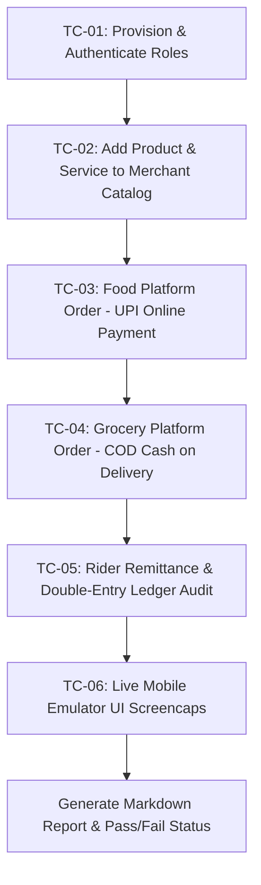

# Grepmind Near — Complete End-to-End UI & Platform Automation Suite Guide

This guide provides exhaustive operational and architectural documentation for the **Complete End-to-End UI & Platform Automation Suite** in Grepmind Near.

---

## 1. Overview & Objectives

The automation suite validates the entire Grepmind Near local commerce and delivery lifecycle across all primary roles (**Customer**, **Merchant**, **Rider**, and **Platform Admin**). It executes automated integration and UI validation covering the 5 core activities:

1. **Role Provisioning & Isolated OTP Authentication**: Secure OTP challenge reading and token caching across all platform roles.
2. **Merchant Catalog Management**: Dynamic addition and verification of products (finite stock, pricing) and services (indicative rates).
3. **Food Platform Commerce (Prepaid UPI)**: Quotation, checkout, payment intent/sandbox capture, kitchen preparation, rider dispatch, dual-handshake verification (8-digit pickup code + 8-digit delivery code), and zero COD liability assertion.
4. **Grocery Platform Commerce (Cash on Delivery - COD)**: Quotation, order packing, dispatch, rider custody verification, customer handover, and cash liability recording in `cod_obligations`.
5. **Rider Remittance & Multi-Person Settlement**: Cash liability remittance by rider, safe deposit verification by Admin, merchant payable accrual, settlement batch review/approval under separation-of-duties, and double-entry ledger balance audit (`sum(debit) == sum(credit)`).
6. **Multi-Emulator Android UI Verification**: Simultaneous screenshot capture across assigned emulators via Android Debug Bridge (ADB).

---

## 2. Architecture & File Inventory

The suite is composed of two primary orchestration files located in `scripts/qa/`:

| File | Purpose |
|---|---|
| [`scripts/qa/run-complete-e2e-suite.ps1`](file:///d:/grepmind-near/scripts/qa/run-complete-e2e-suite.ps1) | **PowerShell Orchestrator**: Handles user CLI parameters, locates active QA environment files in WSL, configures environment variables, and launches the test engine. |
| [`scripts/qa/run-complete-e2e-suite.mjs`](file:///d:/grepmind-near/scripts/qa/run-complete-e2e-suite.mjs) | **Node.js Test Engine**: Executes HTTP requests against isolated QA endpoints, queries PostgreSQL for state and invariants, drives dispatch state machines, and interfaces with ADB for emulator screencaps. |
| `reports/` | Output directory storing timestamped Markdown test execution reports (e.g. `reports/e2e-ui-automation-report-<timestamp>.md`). |
| `reports/evidence/` | Directory storing live Android UI screencaps (`customer_live.png`, `merchant_live.png`, `rider_live.png`). |

---

## 3. Dedicated Role Mappings & Runtime Environment

### Role Mappings

| Role | Assigned Identity | Physical Surface / AVD | Expected Serial |
|---|---|---|---|
| **Customer** | Synthetic QA (`+919990000171`) | `Pixel_8` | `emulator-5554` (or `emulator-5560`) |
| **Merchant** | Synthetic QA (`+919990000172`) | `Pixel_8_Merchant_QA` | `emulator-5556` (or `emulator-5558`) |
| **Rider** | Synthetic QA (`+919990000173`) | `Pixel_8_Rider_QA` | `emulator-5558` (or `emulator-5556`) |
| **Admin 1 (Dispatch)** | Allowlisted Admin (`+919990000174`) | Web / API | N/A |
| **Admin 2 (Reviewer)** | Allowlisted Admin (`+919990000176`) | Web / API | N/A |
| **Admin 3 (Approver)** | Allowlisted Admin (`+919990000175`) | Web / API | N/A |

### Prerequisites

1. **Docker QA Containers Running**:
   - `grepmind_4c_qa_api` on `http://127.0.0.1:18083`
   - `grepmind_4c_qa_otp_inbox` on `http://127.0.0.1:18085`
   - `grepmind_3e_qa_db` on `127.0.0.1:55432`
2. **Android Emulators**: Running and accessible via ADB (`adb devices -l`).

---

## 4. How to Execute the Suite

### Basic Execution (Default QA Configuration)

Open an interactive PowerShell terminal at the repository root and run:

```powershell
powershell -ExecutionPolicy Bypass -File scripts\qa\run-complete-e2e-suite.ps1
```

### Custom Execution (Providing Custom Inputs)

You can pass custom mobile numbers, product names, service names, and prices via CLI arguments:

```powershell
powershell -ExecutionPolicy Bypass -File scripts\qa\run-complete-e2e-suite.ps1 `
  -CustomerPhone "+919990000171" `
  -MerchantPhone "+919990000172" `
  -RiderPhone "+919990000173" `
  -ProductName "Artisanal Organic Darjeeling Tea" `
  -ProductPrice 285.0 `
  -ServiceName "Standard Wiring Inspection" `
  -ServicePrice 350.0
```

### Headless / CI Execution (Skipping Physical Emulators)

To run the full commerce, dispatch, and ledger suite without querying ADB or emulators:

```powershell
powershell -ExecutionPolicy Bypass -File scripts\qa\run-complete-e2e-suite.ps1 -SkipEmulators
```

### Specifying a Custom Report Output File

```powershell
powershell -ExecutionPolicy Bypass -File scripts\qa\run-complete-e2e-suite.ps1 `
  -ReportFile "reports/my-custom-test-run.md"
```

---

## 5. Detailed Test Scenario Specifications



### [TC-01] Account Provisioning & Isolated OTP Authentication

- **Purpose**: Authenticates each role via synthetic allowlisted numbers using the challenge-bound isolated QA OTP reader.
- **Workflow**:
  1. Requests OTP challenge from `/api/v1/auth/otp/request` for Customer, Merchant, Rider, and 3 Admin roles.
  2. Queries isolated OTP inbox (`http://127.0.0.1:18085/api/v1/qa/otp/challenges/:challengeId`) to safely resolve code without leaking into application logs.
  3. Verifies OTP via `/api/v1/auth/otp/verify` and caches session JWTs in `/tmp/qa_tokens_suite_cache.json`.
  4. Verifies Customer delivery address exists (`GET /api/v1/customer/addresses`), creating a default Cuttack address if empty.
  5. Confirms Merchant business ownership and unlocks Rider availability lease (`is_online=true`, `status='approved'`).

### [TC-02] Merchant Catalog Management (Add Product & Add Service)

- **Purpose**: Adds new inventory items under the authenticated Merchant and verifies immediate storefront visibility.
- **Workflow**:
  1. **Add Product**: Calls `POST /api/v1/merchant/products?business_id={id}` with:
     - `name`: Product title (e.g. `Artisanal Cardamom Chai Blend`)
     - `price`: Product price in INR (e.g. `245.00`)
     - `stock_status`: `in_stock`, `inventory_mode`: `finite`, `available_quantity`: `45`
     - `is_published`: `true`, `image_url`: Unsplash CDN reference.
  2. **Add Service**: Calls `POST /api/v1/merchant/services?business_id={id}` with:
     - `name`: Service title (e.g. `Certified Appliance Safety Audit`)
     - `indicative_price_min`: Base price (e.g. `399.00`)
     - `indicative_price_max`: Max price bracket (e.g. `599.00`)
     - `is_active`: `true`.
  3. **Verification**: Calls `GET /api/v1/merchant/products` and `GET /api/v1/merchant/services` and asserts the created IDs exist in the merchant's catalog.

### [TC-03] Food Commerce Order with UPI Payment & Dual-Code Delivery

- **Purpose**: Validates the end-to-end delivery lifecycle for prepaid digital commerce orders.
- **Workflow**:
  1. **Quote**: Customer requests quotation for Food item (`POST /api/v1/platform/orders/quote`).
  2. **Checkout**: Customer places order with `payment_method: 'upi'` (`POST /api/v1/platform/orders`).
  3. **Sandbox Capture**: Creates payment intent (`POST /orders/:id/payment-intents`), session, and simulates `succeeded` outcome (`POST /orders/:id/sandbox-payment-outcomes`).
  4. **Fulfillment Pipeline**:
     - Merchant accepts: `POST /merchant/businesses/:bizId/platform-orders/:id/accept`
     - Merchant prepares: `POST /merchant/businesses/:bizId/platform-orders/:id/prepare` (spawns `delivery_jobs` entry)
     - Merchant marks ready: `POST /merchant/businesses/:bizId/platform-orders/:id/ready`.
  5. **Dispatch & Assignment**: Dispatch engine issues offer to eligible Rider (`GET /api/v1/rider/offers`); Rider accepts (`POST /rider/offers/:id/accept`).
  6. **Pickup Handshake**:
     - Rider advances to `arriving_at_pickup` -> `at_pickup`.
     - Merchant generates 8-digit pickup code (`POST /merchant/businesses/:bizId/delivery-jobs/:id/pickup-code`).
     - Rider verifies code (`POST /rider/delivery-jobs/:id/pickup/verify`). Custody transfers to Rider.
  7. **Delivery Handshake**:
     - Rider transitions to `en_route`.
     - Customer generates 8-digit delivery code (`POST /orders/:id/delivery-code`).
     - Rider confirms handover (`POST /rider/delivery-jobs/:id/delivery/confirm`) with `confirm_cod_collection: false`.
  8. **Assertion**: Verifies status is `delivered` and COD cash liability is **₹0.00**.

### [TC-04] Grocery Commerce Order with COD Payment & Dual-Code Delivery

- **Purpose**: Validates cash-on-delivery handling, customer code verification, and physical cash collection.
- **Workflow**:
  1. **Quote & Checkout**: Customer orders Grocery item with `payment_method: 'cash_on_delivery'`.
  2. **Merchant Pack**: Merchant accepts, prepares, and marks grocery order ready.
  3. **Dispatch & Handshake**: Rider accepts delivery job, verifies 8-digit pickup code at grocery partner, and transitions to `en_route`.
  4. **Handover & Cash Collection**:
     - Customer generates 8-digit delivery code.
     - Rider inputs code and confirms cash collection with `confirm_cod_collection: true`.
  5. **Liability Accounting**:
     - Order marked `delivered`.
     - Cash collected is recorded in `cod_obligations` and debited to `rider_cash_receivable`.

### [TC-05] Rider COD Remittance & Settlement Double-Entry Ledger Verification

- **Purpose**: Verifies that rider liability is discharged, merchant payables are accrued, and double-entry financial journals remain balanced.
- **Workflow**:
  1. **Remittance**: Rider submits cash deposit remittance (`POST /api/v1/rider/cash-remittances`).
  2. **Admin Safe Deposit Verification**: Admin 1 verifies physical safe deposit (`POST /api/v1/admin/cash-remittances/:id/verify`), reducing rider liability to ₹0.00.
  3. **Merchant Payable Accrual**: Admin accrues net payable for the completed order (`POST /api/v1/admin/finance/accrue-order-payables`).
  4. **Multi-Person Settlement Governance**:
     - Admin 2 reviews settlement batch (`POST /admin/finance/settlements/:id/review`).
     - Admin 3 approves settlement batch (`POST /admin/finance/settlements/:id/approve`) under separation-of-duties.
  5. **Double-Entry Ledger Audit**: Executes PostgreSQL verification query across all journals:
     ```sql
     SELECT j.id
     FROM financial_journals j
     JOIN financial_postings p ON p.journal_id = j.id
     GROUP BY j.id
     HAVING SUM(CASE WHEN p.side = 'debit' THEN p.amount_minor ELSE -p.amount_minor END) <> 0;
     ```
     **Assertion**: Zero rows returned. Invariant `sum(debit) == sum(credit)` holds 100%.

### [TC-06] Live Multi-Emulator UI State Verification & Screenshot Capture

- **Purpose**: Verifies the visual state of active Android emulators and stores photographic evidence.
- **Workflow**:
  1. Identifies active emulators via `adb devices -l`.
  2. Runs `exec-out screencap -p` across assigned device serials:
     - `emulator-5554` (Customer): Saved to `reports/evidence/customer_live.png`
     - `emulator-5556` (Merchant): Saved to `reports/evidence/merchant_live.png`
     - `emulator-5558` (Rider): Saved to `reports/evidence/rider_live.png`
  3. Embeds evidence paths in the final Markdown report.

---

## 6. Interpreting Test Reports

Upon test completion, a Markdown report is saved under `reports/`. Each report includes:

1. **Executive Summary Scorecard**: Total scenarios, pass/fail counts, total execution time, and double-entry ledger status.
2. **Execution Breakdown Table**: Individual status, execution latency (in seconds), and key references (Order reference codes, delivery job IDs, remittance IDs).
3. **Detailed Activity Evidence**: Breakdown of newly created product/service IDs, 8-digit verification codes, and financial UTR references.
4. **Financial Ledger Verification**: Proof that debits equal credits across all generated financial postings.
5. **Screenshot Evidence**: Relative links to emulator screens captured during the run.

---

## 7. Troubleshooting & FAQ

### Issue: Rate limited on OTP generation
- **Cause**: Too many OTP requests within a 60-second window.
- **Resolution**: The test runner automatically waits for the cooldown period and retries up to 8 times. Reused tokens are cached in `/tmp/qa_tokens_suite_cache.json` to prevent unnecessary OTP calls.

### Issue: `adb: not found` or Emulators not detected
- **Cause**: Android SDK platform tools not found on standard Windows path.
- **Resolution**: The runner automatically checks `D:\emulator\android-sdk\platform-tools\adb.exe` and falls back to system `PATH`. Run `adb devices -l` in host PowerShell to ensure emulators are online. If running headlessly, pass `-SkipEmulators`.

### Issue: Database connection failure in WSL
- **Cause**: Docker service or QA PostgreSQL container stopped.
- **Resolution**: Verify container status by running `docker ps`. Ensure `grepmind_3e_qa_db` is listening on port `55432`.
